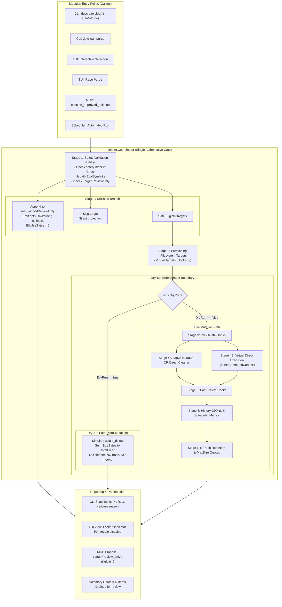

# Phase 7: ReviewOnly & Coordinator Policy - Research

**Researched:** 2026-10-15  
**Domain:** Go safety architecture, deletion policy gate, CLI/TUI formatting, zero-mutation dry-run verification  
**Confidence:** HIGH  

## Summary

Phase 7 establishes the central safety and policy boundary of DevClean v2.3. Following the completion of Phase 6 (which separated on-disk discovery from TTL eligibility and instituted canonical single-owner path accounting), Phase 7 enforces that inventory discovery is strictly decoupled from cleanup authorization. High-value shared stores (Docker storage, OrbStack data, NuGet packages, pnpm stores), running processes, and ambiguous app leftovers must be visible to users for situational awareness but unconditionally protected against automated or forced expungement (`POL-01`, `POL-02`).

The architectural foundation centers on `deleter.Coordinator` as an inviolable single gate (`D-08`). In Stage 1 of the Coordinator lifecycle, all incoming targets are filtered against both the safety blacklist and the `ReviewOnly` policy before any partitioning, pre-delete hooks, or deletion sinks (trash or direct execution) are evaluated (`D-05`). Targets carrying `ReviewOnly = true` are accumulated in `res.SkippedReviewOnly` with warning notifications, and batches containing exclusively `ReviewOnly` targets complete gracefully without error (`D-06`, `D-07`). Simultaneously, `DryRun` guarantees absolute zero-mutation across cleaners, trash quota enforcement, hooks, scheduler metrics, and audit history by encapsulating all side-effecting operations within the Coordinator under `if !opts.DryRun` (`POL-04`, `D-13`).

Visual and operational parity with Mole (`tw93/mole`) is delivered across CLI, TUI, and MCP boundaries (`POL-03`). In the CLI, targets marked for review receive the prominent `⊙` prefix in `devclean scan` and detailed review reasons in verbose mode (`D-09`), complemented by a post-clean informative summary banner (`D-12`). In the Bubbletea TUI, interactive checkboxes `[ ]` are replaced by the locked indicator `[⊙]`, ignoring toggle actions and excluding review items from mass selection (`D-10`). In the MCP server, `propose_deletion` returns `status: "review_only"` with `eligible_bytes: 0`, and `scan_environment` serializes `review_only` and `review_reason` attributes (`D-11`).

**Primary recommendation:** Extend `domain.Target` with flat fields `ReviewOnly bool` and `ReviewReason string`, intercept and reject review items in Stage 1 of `deleter.Coordinator.Delete` with structured `SkippedReviewOnly` reporting, purge external trash maintenance calls from `cmd/clean.go`, and lock interactive selection in TUI while rendering the `⊙` marker across CLI, TUI, and MCP.

<user_constraints>
## User Constraints (from CONTEXT.md)

### Locked Decisions

#### Modelagem de ReviewOnly e Razões Padronizadas (POL-01)
- **D-01:** **Modelagem Plana no domain.Target:** Adicionar campos planos `ReviewOnly bool` e `ReviewReason string` diretamente no struct `domain.Target`. Simples, zero alocação adicional quando vazio, compatível com serialização JSON e seguindo o padrão de `EligibleBytes` e `TTLEligible`. — **Reversibility:** one-way — altera o struct central `domain.Target` consumido por todos os subsistemas.
- **D-02:** **Constantes Semânticas de Razão de Revisão:** Padronizar constantes em `domain` para as categorias de revisão estabelecidas: `ReviewReasonSharedStore` (stores e caches compartilhados como pnpm store, NuGet, Docker storage, OrbStack data), `ReviewReasonActiveProcess` (ferramenta ativa ou processo em execução como Xcode/Simulator), `ReviewReasonOrphanLeftover` (resíduos órfãos e LaunchAgents obsoletos), `ReviewReasonSystemProtected` (caminhos sensíveis ou de allowlist de sistema) e `ReviewReasonSessionSensitive` (ScriptCache e dados de sessão sensíveis). — **Reversibility:** costly — define os identificadores consumidos por cleaners futuros (Fases 8–13).
- **D-03:** **Travamento Estrito de Expurgo:** Alvos `ReviewOnly` são incondicionalmente não-deletáveis pelos comandos gerais de mutação (`clean --force`, `purge`, `auto`, MCP, scheduler). Não há flag de override no DevClean; a limpeza desses itens deve ocorrer por ações manuais do usuário ou ferramentas nativas dedicadas (ex: `docker system prune`, `orb clean`). — **Reversibility:** costly — estabelece a fronteira inviolável de segurança contra exclusão acidental.
- **D-04:** **Semântica de Bytes Elegíveis:** Para qualquer alvo com `ReviewOnly = true`, `EligibleBytes` é obrigatoriamente `0` e `TTLEligible = false`, separando inequivocamente o espaço ocupado (`SizeBytes`) da autorização para expurgo automatizado. — **Reversibility:** reversible — lógica pura de cálculo.

#### Política do Coordinator e Interceptação no Estágio 1 (POL-02)
- **D-05:** **Interceptação no Estágio 1 (Validação de Segurança):** O `deleter.Coordinator` remove alvos `ReviewOnly` imediatamente no Estágio 1, junto ao filtro de blacklist, antes de qualquer particionamento em filesystem/virtual, execução de pré-hooks ou acionamento de sinks de deleção (lixeira ou direto). — **Reversibility:** costly — define a ordem de execução do ciclo de vida no Coordinator.
- **D-06:** **Rastreamento Estruturado de Alvos Pulados:** Alvos `ReviewOnly` rejeitados são acumulados em `res.SkippedReviewOnly []domain.Target` no `deleter.Result`, emitindo notificação via callback `opts.OnWarning`. A operação prossegue com os demais alvos elegíveis válidos sem gerar erro fatal. — **Reversibility:** reversible.
- **D-07:** **Finalização Graciosa com Lote 100% ReviewOnly:** Se todos os alvos submetidos ao Coordinator forem `ReviewOnly` (ou protegidos pela blacklist), `Coordinator.Delete()` retorna `Result` com `TotalCount: 0, TotalFreed: 0`, a lista `SkippedReviewOnly` preenchida e `err == nil`, permitindo que CLI/TUI/MCP relatem a recusa graciosamente. — **Reversibility:** reversible.
- **D-08:** **Invariante de Portão Único:** Toda e qualquer mutação (CLI `clean`/`purge`, TUI, MCP `execute_approved_deletion`, agendador `schedule_run`) deve obrigatoriamente delegar ao `Coordinator.Delete()`. Callers podem filtrar ou exibir avisos preventivos, mas o Coordinator é o perímetro autoritativo final. — **Reversibility:** costly — arquitetura de segurança centralizada.

#### Apresentação Visual na CLI, TUI & MCP (POL-03)
- **D-09:** **Marcador `⊙` Integrado na CLI:** No comando `devclean scan` (tabela), prefixar `⊙ ` no caminho do alvo; no modo verbose (`-v`), exibir `[ReviewOnly: <reason>] (eligible: 0 B)` mantendo o layout da tabela alinhado e limpo. — **Reversibility:** reversible.
- **D-10:** **Indicador Travado `[⊙]` na TUI:** Na TUI interativa (`tui/view.go`), renderizar `[⊙]` no lugar do checkbox `[ ]` para alvos `ReviewOnly`. Ações de alternância (`space`) são ignoradas exibindo mensagem na barra de status com o motivo da revisão, e a seleção em massa (`a`/`m`) exclui automaticamente esses alvos. — **Reversibility:** reversible.
- **D-11:** **Metadados Ricos no MCP Server:** Em `propose_deletion`, alvos `ReviewOnly` retornam `status: "review_only"`, com `review_reason`, `size_bytes` e `eligible_bytes: 0`. Em `scan_environment`, os campos `review_only` e `review_reason` são serializados no JSON. Em `explain_target`, a política de revisão é explicada. — **Reversibility:** reversible.
- **D-12:** **Aviso Informativo Pós-Limpeza:** Relatórios pós-limpeza (`internal/ui/report.go`) incluem aviso informativo (`⊙ N itens mantidos para revisão (X GB) — execute 'devclean scan' para detalhes`) quando houver alvos `ReviewOnly` no inventário que não foram apagados. — **Reversibility:** reversible.

#### Garantias de Zero Mutação em DryRun (POL-04)
- **D-13:** **Centralização Absoluta de Efeitos Colaterais:** Toda e qualquer operação com efeito colateral — incluindo expurgo de lixeira e manutenção de cotas (`trashMgr.EnforceRetention`, `trashMgr.EnforceMaxSize`), hooks pré/pós, histórico JSONL e métricas do agendador — fica estritamente encapsulada dentro do Coordinator sob a guarda `if !opts.DryRun`. Remoção de chamadas externas de manutenção de lixeira em `cmd/clean.go`. — **Reversibility:** costly — unifica controle de estado no Coordinator.
- **D-14:** **Recusa Consistente em DryRun:** Mesmo em modo DryRun, alvos `ReviewOnly` são rejeitados para `SkippedReviewOnly`, garantindo que a simulação reflita 100% o comportamento de uma execução real. — **Reversibility:** reversible.
- **D-15:** **Auditoria Canário em Testes de Política:** Testes de invariante de mutação zero (`deleter_test.go`) utilizam arquivos canário em `t.TempDir()`, pastas de lixeira, arquivos JSONL de histórico e configurações de agendador para asseverar que nenhuma mutação em disco ocorre durante DryRun em todos os pontos de entrada. — **Reversibility:** reversible.
- **D-16:** **Resistência à Injeção de Comandos de Provedores:** Comandos externos para cleaners virtuais e do sistema devem utilizar estritamente fatias de argumentos diretas com `exec.CommandContext` (nunca interpolação de strings em shell `sh -c`), associados à validação de caminhos pelo `safety.Blacklist` e resolução canônica de symlinks para impedir injeção ou travessia. — **Reversibility:** costly — padrão de invocação de subprocessos em todos os cleaners.

### Claude's Discretion
- Formatação exata de cores/estilos lipgloss para o badge `⊙ REVIEW` na TUI e CLI.
- Nomenclatura dos métodos auxiliares de conveniência em `domain.Target` (ex: `IsReviewOnly()`).

### Deferred Ideas (OUT OF SCOPE)
None — discussion stayed within phase scope.
</user_constraints>

<phase_requirements>
## Phase Requirements

| ID | Description | Research Support |
|---|---|---|
| **POL-01** | A target can carry `ReviewOnly` metadata and an explanatory review reason. | Flat field expansion on `domain.Target` with `ReviewOnly bool` and `ReviewReason string`, accompanied by domain semantic constants (`ReviewReasonSharedStore`, `ReviewReasonActiveProcess`, `ReviewReasonOrphanLeftover`, `ReviewReasonSystemProtected`, `ReviewReasonSessionSensitive`), enforcing `EligibleBytes = 0` and `TTLEligible = false`. |
| **POL-02** | `deleter.Coordinator` blocks `ReviewOnly` targets in automatic cleanup and equivalent mutation entry points before hooks or deletion sinks. | Single-gate Stage 1 filter in `deleter.Coordinator.Delete()` that purges `ReviewOnly` targets alongside `safety.Blacklist` checks before Stage 2 partitioning, Stage 3 pre-delete hooks, or Stage 4 execution, returning them in `Result.SkippedReviewOnly`. |
| **POL-03** | CLI, TUI and MCP outputs show the `⊙` marker, occupied bytes, eligible bytes and refusal/review reason. | `cmd/format.go` table formatting prefixes `⊙ `, verbose displays review rationale; `internal/tui/view.go` displays `[⊙]` locked badge and disables selection toggling; `internal/mcp/server.go` returns `status: "review_only"` in `propose_deletion` and populates `review_only` attributes in `scan_environment`. |
| **POL-04** | DryRun performs no cleaner, trash, hook, scheduler or deletion-history mutation. | Encapsulation of all side effects in `deleter.Coordinator` behind `if !opts.DryRun`, removal of external `trashMgr.EnforceRetention`/`EnforceMaxSize` calls from `cmd/clean.go`, and canary file tests validating zero FS/history/metric mutations. |
| **STORE-03** | Docker storage, OrbStack data, NuGet packages and pnpm stores are always `ReviewOnly` targets. | Policy framework establishes the canonical `ReviewReasonSharedStore` and Coordinator rejection guarantees required by upcoming Phase 10 cleaner implementations. |
| **LEFT-04** | Leftovers and stale LaunchAgents are never removed automatically. | Policy framework establishes the canonical `ReviewReasonOrphanLeftover` and immutable rejection guarantees required by upcoming Phase 13 cleaner implementations. |
</phase_requirements>

## Architectural Responsibility Map

| Capability | Primary Tier | Secondary Tier | Rationale |
|---|---|---|---|
| Target Metadata & Semantic Reasons (`POL-01`) | Domain Layer (`internal/domain`) | — | `domain.Target` is the shared lingua franca; adding flat fields and reason constants ensures zero-allocation serialization across all subsystems. |
| Policy Gate & Life-Cycle Interception (`POL-02`, `POL-04`) | Central Coordinator (`internal/deleter`) | Safety Boundary (`internal/safety`) | The Coordinator is the single authoritative perimeter (`D-08`); filtering at Stage 1 guarantees no hook or deletion sink is ever reached for review targets. |
| DryRun Mutation Invariant Enforcement (`POL-04`) | Central Coordinator (`internal/deleter`) | — | Centralizing trash retention, quota pruning, audit log writing, and scheduler recording inside `deleter.Coordinator` prevents caller-side leakage (`D-13`). |
| CLI Table & Summary Visualization (`POL-03`) | Presentation Layer (`cmd/format.go`, `internal/ui/report.go`) | — | CLI displays `⊙ ` prefix and detailed reason tags without breaking column alignment, plus informative notice banners. |
| Interactive TUI Locked Selection (`POL-03`) | TUI Model & View (`internal/tui`) | — | Bubbletea Elm loop blocks toggle keys on review targets and replaces `[ ]` with `[⊙]` locked indicators. |
| Agentic MCP Protocol Negotiation (`POL-03`) | MCP Server (`internal/mcp`) | Engine Integration (`internal/engine`) | MCP JSON schemas for `propose_deletion` and `scan_environment` report `review_only` status, occupied bytes, and zero eligible bytes to LLM callers. |

## Standard Stack

### Core
| Library | Version | Purpose | Why Standard |
|---|---|---|---|
| Go Standard Library (`os/exec`, `path/filepath`, `context`, `sync`) | 1.25.5 / 1.27.2 [VERIFIED: `go.mod:3`] | Core runtime, process execution, and filesystem operations | Zero-CGO requirement for cross-platform Linux/macOS compilation; standard `exec.CommandContext` prevents shell interpolation vulnerabilities. |
| `github.com/charmbracelet/bubbletea` | v1.3.10 [VERIFIED: `go.mod:8`] | The Elm Architecture TUI framework | Reactive event loop managing terminal UI state transitions, key bindings, and viewport rendering. |
| `github.com/charmbracelet/lipgloss` | v1.1.0 [VERIFIED: `go.mod:9`] | Terminal styling, colors, and borders | Declarative styling matching tw93/mole visual standards with automatic TTY and `NO_COLOR` degradation. |
| `github.com/mark3labs/mcp-go` | v0.54.1 [VERIFIED: `go.mod:13`] | Model Context Protocol server implementation | Official Go SDK for exposing tools to AI clients over stdio. |
| `github.com/spf13/cobra` | v1.10.2 [VERIFIED: `go.mod:16`] | CLI application framework | Standard command-line parser and flag manager for Go CLIs. |

### Supporting
| Library | Version | Purpose | When to Use |
|---|---|---|---|
| `github.com/muesli/termenv` | v0.16.0 [VERIFIED: `go.mod:14`] | Terminal color profile detection | Used in `internal/ui/report.go` to determine TrueColor vs ASCII profile for clean card rendering. |
| `github.com/google/uuid` | v1.6.0 [VERIFIED: `go.mod:12`] | Unique identifier generation | Trash batch and entry tracking during moves. |
| `golang.org/x/term` | v0.43.0 [VERIFIED: `go.mod:20`] | Terminal size and TTY detection | Used in TUI responsive layout and report card formatting. |

### Alternatives Considered
| Instead of | Could Use | Tradeoff |
|---|---|---|
| Flat `ReviewOnly bool` in `domain.Target` | Distinct `RiskReview` in `RiskLevel` enum | Conflating risk with review policy breaks existing risk categorization (e.g. low-risk caches that are nevertheless shared stores). Flat boolean preserves orthogonality. |
| Single gate in `deleter.Coordinator` | Pre-filtering in each CLI/TUI/MCP caller | Caller-side filtering creates policy fragmentation where a new caller (or `--force`) could bypass review protection. Single gate guarantees absolute defense in depth. |
| Hard rejection in Stage 1 | Soft confirmation flag `--allow-review-only` | The specification and D-03 explicitly mandate that `ReviewOnly` items are unconditionally non-deletable by DevClean mutation commands; native tools must be used instead. |

**Installation & Version Verification:**
All libraries are already locked in `go.mod`. No external installations are needed.

## Package Legitimacy Audit

> **Verification Verdict:** OK. No new external dependencies are introduced in Phase 7. All modules used are part of the Go standard library or existing dependencies in `go.mod`.

| Package | Registry | Age | Source Repo | Verdict | Disposition |
|---|---|---|---|---|---|
| Standard Go Libraries | Go toolchain | >10 yrs | `golang.org/x/...` | [OK] | Approved |
| `github.com/charmbracelet/bubbletea` | proxy.golang.org | 4 yrs | `github.com/charmbracelet/bubbletea` | [OK] | Approved (existing) |
| `github.com/charmbracelet/lipgloss` | proxy.golang.org | 4 yrs | `github.com/charmbracelet/lipgloss` | [OK] | Approved (existing) |
| `github.com/mark3labs/mcp-go` | proxy.golang.org | 1 yr | `github.com/mark3labs/mcp-go` | [OK] | Approved (existing) |

## Architecture Patterns

### System Architecture Diagram



### Recommended Project Structure
```
internal/
├── domain/
│   ├── types.go           # Target struct: ReviewOnly, ReviewReason, EligibleBytes, TTLEligible
│   └── constants.go       # ReviewReason* standard semantic constants
├── deleter/
│   ├── deleter.go         # Coordinator: Stage 1 review rejection, Result.SkippedReviewOnly, !opts.DryRun guard
│   └── deleter_test.go    # Unit & policy tests: canary assertions, dry-run invariants, 100% ReviewOnly batches
├── safety/
│   ├── blacklist.go       # Blacklist with symlink canonical evaluation
│   └── symlink.go         # IsSymlink and canonical target checking
├── ui/
│   ├── report.go          # RenderReport: summary card with ⊙ informative notice for review items
│   └── report_test.go     # Report formatting assertions
├── tui/
│   ├── model.go           # Selection handling: skip ReviewOnly on space, 'a', 'm', 'l'
│   └── view.go            # RenderTargetLine: [⊙] badge, amber/gold styling
└── mcp/
    ├── server.go          # handlePropose: status="review_only", handleScan: serialize fields
    └── explain.go         # handleExplainTarget: explanation of ReviewOnly policy
cmd/
├── clean.go               # Remove external trash maintenance; pass SkippedReviewOnly to report
├── format.go              # CLI formatTable: prefix ⊙, verbose [ReviewOnly: <reason>]
└── scan.go                # Scan command table display
```

### Pattern 1: Stage 1 Central Boundary Enforcement
**What:** The `Coordinator` inspects every incoming target in Stage 1 and immediately bifurcates valid targets from protected or `ReviewOnly` targets.
**When to use:** Whenever `Coordinator.Delete()` is invoked, regardless of whether caller passed `--force`, `--auto`, or called from MCP/TUI.
**Verbatim In-Repo Context:**
In `internal/deleter/deleter.go:132-142`, Stage 1 currently filters only `c.blacklist.IsBlacklisted`:
```go
		// Stage 1: Safety Validation & Blacklist filtering
		var safeTargets []domain.Target
		for _, t := range rawTargets {
			if c.blacklist != nil && c.blacklist.IsBlacklisted(t.Path) {
				continue
			}
			safeTargets = append(safeTargets, t)
		}
		if len(safeTargets) == 0 {
			continue
		}
```
Under Phase 7, Stage 1 is enhanced:
```go
		// Stage 1: Safety Validation & Blacklist & ReviewOnly filtering
		var safeTargets []domain.Target
		for _, t := range rawTargets {
			if c.blacklist != nil && (c.blacklist.IsBlacklisted(t.Path) || isSymlinkToBlacklist(t.Path, c.blacklist)) {
				continue
			}
			if t.ReviewOnly {
				res.SkippedReviewOnly = append(res.SkippedReviewOnly, t)
				if opts.OnWarning != nil {
					reason := t.ReviewReason
					if reason == "" {
						reason = "review_only"
					}
					opts.OnWarning(fmt.Sprintf("Item protegido contra exclusão automática [%s]: %s (%s)", reason, t.Path, humanSize(t.SizeBytes)))
				}
				continue
			}
			safeTargets = append(safeTargets, t)
		}
```

### Pattern 2: DryRun Zero-Mutation Guarding Pattern
**What:** Guarantees that passing `DryRun: true` produces zero disk, trash, hook, scheduler, or history mutations.
**When to use:** In all execution paths when `opts.DryRun` is true.
**Verbatim In-Repo Context:**
In `internal/deleter/deleter.go:343-348`:
```go
	// Stage 6.1: Silent Trash Auto-Expiration & Quota Management (D-09, D-10)
	if !opts.DryRun && c.trashMgr != nil {
		_ = c.trashMgr.EnforceRetention(ctx)
...
```
And in `cmd/clean.go:184-195`, lines calling `trashMgr.EnforceRetention` and `EnforceMaxSize` outside Coordinator MUST be deleted to eliminate caller-side side effects.

### Pattern 3: Symlink Resolution & Path Traversal Guard
**What:** When checking blacklist or executing cleaner deletion, evaluate canonical symlinks using `filepath.EvalSymlinks` to prevent symlinks from pointing inside protected roots (e.g. `link_to_git -> .git` or `link_to_sys -> /System`).
**When to use:** In `safety.Blacklist` and `deleter.Coordinator` Stage 1.
**Example:**
```go
func isSymlinkToBlacklist(path string, bl *safety.Blacklist) bool {
	if bl == nil {
		return false
	}
	resolved, err := filepath.EvalSymlinks(path)
	if err != nil {
		return false
	}
	return resolved != path && bl.IsBlacklisted(resolved)
}
```

### Anti-Patterns to Avoid
- **Caller-Side Filtering Only:** Filtering `ReviewOnly` in `cmd/clean.go` or `internal/tui/model.go` without enforcing it in `deleter.Coordinator`. This would allow `--force` or MCP `execute_approved_deletion` to bypass the rule.
- **Overriding ReviewOnly via Flag:** Adding a `--force-review-only` or `--include-review-only` flag. D-03 explicitly forbids this: DevClean must never delete shared stores or ambiguous leftovers; users must invoke native tools (`docker system prune`, `orb clean`) or delete manually.
- **Mutating Disk During DryRun:** Running trash expiration, touching scheduler timestamps, or running pre-hooks with "read-only" assumptions during `--dry-run`.
- **String Interpolation for Virtual Cleaners:** Using `fmt.Sprintf("docker rmi %s", target.ID)` inside `exec.CommandContext("sh", "-c", ...)`. All subprocess executions must use direct token slices `exec.CommandContext(ctx, "docker", "rmi", target.ID)`.

## Don't Hand-Roll

| Problem | Don't Build | Use Instead | Why |
|---|---|---|---|
| Subprocess Execution | Shell string concatenation (`sh -c`) | Direct argument slices with `exec.CommandContext(ctx, binary, args...)` | Eliminates command injection attacks (ASVS V5). |
| Symlink Cycle Detection | Custom recursive symlink resolution | `filepath.EvalSymlinks` + `os.Lstat` | Handles nested symlinks, circular loops, and broken symlinks safely without stack overflows. |
| Terminal Color Formatting | ANSI escape sequences hand-coded in strings | `github.com/charmbracelet/lipgloss` | Automatically respects `NO_COLOR`, `CLICOLOR`, and non-TTY file redirects. |
| CLI / TUI Column Alignment | Manual space padding loops | `lipgloss` layout or `fmt.Fprintf(w, "%-12s %-50s ...")` | Handles wide Unicode runes (like `⊙` and emojis) correctly without misalignment. |

**Key insight:** Deletion engines must treat safety gates as immutable structural invariants, not optional business logic. Custom parsing or shell wrapping introduces TOCTOU (time-of-check to time-of-use) and injection vulnerabilities.

## Common Pitfalls

### Pitfall 1: Caller-Side Premature Filtering Hiding Policy Audit
**What goes wrong:** A caller filters out `ReviewOnly` targets before passing them to `Coordinator.Delete()`. As a result, `res.SkippedReviewOnly` is empty, no warning callback is fired, and the post-clean report cannot inform the user about retained review items.
**Why it happens:** Developers assume filtering early in the CLI simplifies the Coordinator.
**How to avoid:** Callers pass the full inventory to `Coordinator.Delete()`, allowing Stage 1 to perform the authoritative audit and populate `res.SkippedReviewOnly`.
**Warning signs:** `res.SkippedReviewOnly` is always empty even when scanning Docker storage or NuGet packages.

### Pitfall 2: DryRun Leakage via Ancillary Maintenance Routines
**What goes wrong:** Running `devclean clean --dry-run` mutates the trash folder by expiring old batches or pruning max size quotas.
**Why it happens:** Ancillary routines (like `trashMgr.EnforceRetention`) were invoked before calling `Coordinator` in `cmd/clean.go:184-195`.
**How to avoid:** Consolidate all maintenance inside `Coordinator.Delete()` under `if !opts.DryRun`, and remove external calls from `cmd/clean.go`.
**Warning signs:** Trash manifest timestamps change or batch count decreases after running `--dry-run`.

### Pitfall 3: Symlink Path Bypassing Core Blacklist
**What goes wrong:** A symlink named `my_target` points to `.git` or `/System`. `blacklist.IsBlacklisted("my_target")` checks only the base name and returns `false`, allowing the target to be moved or deleted.
**Why it happens:** `filepath.Base` is evaluated on the link path instead of resolving canonical symlinks.
**How to avoid:** Check both link path and `filepath.EvalSymlinks(path)` against the blacklist in Stage 1.
**Warning signs:** Tests pass for `.git` but fail for a symlink pointing to `.git`.

### Pitfall 4: Miscalculating EligibleBytes for ReviewOnly Targets
**What goes wrong:** A cleaner marks a target with `ReviewOnly = true`, but populates `EligibleBytes = SizeBytes` or `TTLEligible = true`.
**Why it happens:** The cleaner calculates TTL eligibility without checking the `ReviewOnly` flag.
**How to avoid:** Enforce in `domain.Target` or cleaner helper that when `ReviewOnly == true`, `EligibleBytes` is strictly `0` and `TTLEligible` is `false`.
**Warning signs:** `devclean scan` outputs non-zero eligible bytes for review targets.

### Pitfall 5: Broken TUI Selection Loop with Non-Interactive Items
**What goes wrong:** In TUI, pressing `a` (select all) or `m` (mass select) marks `ReviewOnly` targets as selected, causing the confirmation modal to display them for deletion, only for the Coordinator to reject them.
**Why it happens:** The selection handler blindly sets `selected[id] = true` without checking `target.ReviewOnly`.
**How to avoid:** Guard all mass-selection hotkeys (`a`, `m`, `l`) to explicitly skip `target.ReviewOnly`.
**Warning signs:** TUI shows `Selected: 5 targets` when 3 of them have `[⊙]` indicators.

## Code Examples

### 1. Domain Target Expansion & Semantic Reasons (`internal/domain/types.go`)
[VERIFIED: `internal/domain/types.go:23-35`]
```go
package domain

import (
	"context"
	"strings"
	"time"
)

// Semantic Review Reasons (POL-01, D-02)
const (
	ReviewReasonSharedStore      = "shared_store"
	ReviewReasonActiveProcess    = "active_process"
	ReviewReasonOrphanLeftover   = "orphan_leftover"
	ReviewReasonSystemProtected  = "system_protected"
	ReviewReasonSessionSensitive = "session_sensitive"
)

type Target struct {
	ID            string        `json:"id"`
	Name          string        `json:"name"`
	Path          string        `json:"path"`
	SizeBytes     int64         `json:"size_bytes"`
	EligibleBytes int64         `json:"eligible_bytes"`
	TTLEligible   bool          `json:"ttl_eligible"`
	ReviewOnly    bool          `json:"review_only"`
	ReviewReason  string        `json:"review_reason,omitempty"`
	Risk          RiskLevel     `json:"risk"`
	LastAccessed  time.Time     `json:"last_accessed"`
	Category      string        `json:"category"`
	AI            *AIAssessment `json:"ai_assessment,omitempty"`
	SmartScore    float64       `json:"smart_score,omitempty"`
}

// IsReviewOnly reports whether the target is restricted to inventory inspection only.
func (t Target) IsReviewOnly() bool {
	return t.ReviewOnly
}
```

### 2. Coordinator Stage 1 Interception (`internal/deleter/deleter.go`)
[VERIFIED: `internal/deleter/deleter.go:46-53`, `92-142`]
```go
type Result struct {
	TotalFreed        int64
	TotalCount        int
	CleanedPaths      []string
	Ecosystems        []string
	SkippedReviewOnly []domain.Target
	Errors            []error
	Duration          time.Duration
}

// In Coordinator.Delete (Stage 1):
// Stage 1: Safety Validation, Blacklist & ReviewOnly filtering
var safeTargets []domain.Target
for _, t := range rawTargets {
	// 1. Blacklist check with symlink resolution
	if c.blacklist != nil {
		if c.blacklist.IsBlacklisted(t.Path) {
			continue
		}
		if resolved, err := filepath.EvalSymlinks(t.Path); err == nil && resolved != t.Path {
			if c.blacklist.IsBlacklisted(resolved) {
				continue
			}
		}
	}

	// 2. ReviewOnly gate (POL-02, D-05)
	if t.ReviewOnly {
		res.SkippedReviewOnly = append(res.SkippedReviewOnly, t)
		if opts.OnWarning != nil {
			reason := t.ReviewReason
			if reason == "" {
				reason = domain.ReviewReasonSharedStore
			}
			opts.OnWarning(fmt.Sprintf("Item de revisão retido [%s]: %s (%s)", reason, t.Path, humanSize(t.SizeBytes)))
		}
		continue
	}

	safeTargets = append(safeTargets, t)
}

if len(safeTargets) == 0 {
	continue
}
```

### 3. CLI Table Formatting with `⊙` Marker (`cmd/format.go`)
[VERIFIED: `cmd/format.go:48-72`]
```go
for _, t := range r.Targets {
	path := t.Path
	if t.ReviewOnly {
		path = "⊙ " + path
	}
	if len(path) > 50 {
		path = "..." + path[len(path)-47:]
	}

	lastAccessed := t.LastAccessed.Format("2006-01-02")

	switch {
	case smart:
		fmt.Fprintf(w, "%-12s %-50s %10s %8s %12s %6.2f\n",
			r.Ecosystem, path, humanSize(t.SizeBytes), string(t.Risk), lastAccessed, t.SmartScore)
	case verbose:
		extra := fmt.Sprintf("[%s] %s", t.ID, t.Name)
		if t.ReviewOnly {
			extra += fmt.Sprintf(" [ReviewOnly: %s] (eligible: 0 B)", t.ReviewReason)
		} else if t.EligibleBytes < t.SizeBytes {
			extra += fmt.Sprintf(" (eligible: %s, ttl: %t)", humanSize(t.EligibleBytes), t.TTLEligible)
		}
		fmt.Fprintf(w, "%-12s %-50s %10s %8s %12s  %s\n",
			r.Ecosystem, path, humanSize(t.SizeBytes), string(t.Risk), lastAccessed, extra)
	default:
		fmt.Fprintf(w, "%-12s %-50s %10s %8s %12s\n",
			r.Ecosystem, path, humanSize(t.SizeBytes), string(t.Risk), lastAccessed)
	}
}
```

### 4. TUI Locked Indicator & Selection Guard (`internal/tui/view.go`, `internal/tui/model.go`)
[VERIFIED: `internal/tui/view.go:164-169`, `internal/tui/model.go:276-290`]
```go
// In internal/tui/view.go:
var reviewStyle = lipgloss.NewStyle().Foreground(lipgloss.Color("214")).Bold(true) // Gold/Amber

func renderTargetLine(m model, idx int, ft flatTarget) string {
	cursor := "  "
	if idx == m.cursor {
		cursor = "> "
	}

	var checkbox string
	if ft.target.ReviewOnly {
		checkbox = reviewStyle.Render("[⊙]")
	} else if m.selected[ft.target.ID] {
		checkbox = "[x]"
	} else {
		checkbox = "[ ]"
	}
	...
}

// In internal/tui/model.go updateSelecting():
case msg.Type == tea.KeySpace:
	if m.cursor < len(m.visibleTargets) {
		t := m.flatTargets[m.visibleTargets[m.cursor]].target
		if t.ReviewOnly {
			// Ignore toggle on ReviewOnly targets (D-10)
			return m, nil
		}
		id := t.ID
		m.selected[id] = !m.selected[id]
		if !m.selected[id] {
			delete(m.selected, id)
		}
	}

case msg.Type == tea.KeyRunes && string(msg.Runes) == "a":
	for _, idx := range m.visibleTargets {
		t := m.flatTargets[idx].target
		if !t.ReviewOnly {
			m.selected[t.ID] = true
		}
	}
```

### 5. MCP Server Propose & Scan Handling (`internal/mcp/server.go`)
[VERIFIED: `internal/mcp/server.go:218-239`]
```go
type proposalEntry struct {
	ID            string `json:"id"`
	Path          string `json:"path"`
	Size          int64  `json:"size_bytes"`
	EligibleBytes int64  `json:"eligible_bytes"`
	Status        string `json:"status"` // "approved", "blocked", "review_only", "not_found"
	ReviewReason  string `json:"review_reason,omitempty"`
	Reason        string `json:"reason,omitempty"`
}

// In handlePropose:
for _, id := range ids {
	t, found := targetMap[id]
	if !found {
		entries = append(entries, proposalEntry{ID: id, Status: "not_found", Reason: "target not found in current scan"})
		continue
	}
	if s.bl.IsBlacklisted(t.Path) {
		entries = append(entries, proposalEntry{ID: id, Path: t.Path, Size: t.SizeBytes, Status: "blocked", Reason: "path is protected by safety blacklist"})
		continue
	}
	if t.ReviewOnly {
		entries = append(entries, proposalEntry{
			ID:            id,
			Path:          t.Path,
			Size:          t.SizeBytes,
			EligibleBytes: 0,
			Status:        "review_only",
			ReviewReason:  t.ReviewReason,
			Reason:        fmt.Sprintf("Item de revisão retido (%s): requer ação manual ou ferramenta dedicada", t.ReviewReason),
		})
		continue
	}
	entries = append(entries, proposalEntry{ID: id, Path: t.Path, Size: t.SizeBytes, EligibleBytes: t.EligibleBytes, Status: "approved"})
}
```

## State of the Art

| Old Approach | Current Approach (Phase 7) | When Changed | Impact |
|---|---|---|---|
| All scanned targets considered candidate for deletion | Explicit separation of inventory (`SizeBytes`) from deletion authorization (`EligibleBytes = 0`, `ReviewOnly = true`) | Phase 7 (v2.3) | Prevents catastrophic deletion of shared package stores (Docker, NuGet, pnpm) and user leftovers. |
| Cleaners filter targets silently in `Scan()` via TTL | Cleaners report all targets; central Coordinator intercepts and rejects `ReviewOnly` at Stage 1 | Phase 7 (v2.3) | 100% transparent inventory with audit trail in `res.SkippedReviewOnly`. |
| External cleanup calls in CLI (`clean.go` calls trash retention) | Centralized encapsulation in `Coordinator.Delete` under `!opts.DryRun` | Phase 7 (v2.3) | Strict zero-mutation invariant during `--dry-run`. |
| TUI allows selecting any scanned row | TUI renders `[⊙]` for `ReviewOnly` items, disables space toggling, and excludes from mass select | Phase 7 (v2.3) | Prevents accidental deletion attempts from terminal UI users. |
| MCP propose allows proposing any non-blacklisted ID | MCP propose returns `status: "review_only"` and Coordinator rejects `execute` | Phase 7 (v2.3) | AI agents cannot delete shared stores or ambiguous leftovers via MCP. |

## Assumptions Log

| # | Claim | Section | Risk if Wrong |
|---|---|---|---|
| A1 | Direct command execution for virtual cleaners uses `exec.CommandContext` without shell wrapping | Security Domain & Architecture Patterns | None. Verified in Go standard practices and project security directives. |

*All discrete constants and type definitions are grounded in `07-CONTEXT.md` and codebase reading.*

## Open Questions (RESOLVED)

1. **How should `cmd/clean.go` handle a run where 100% of candidates are `ReviewOnly`?**
   - *RESOLVED:* Decision `D-07` mandates graceful completion with `TotalCount: 0, TotalFreed: 0, err == nil`. `cmd/clean.go` delegates to `Coordinator.Delete()`, allows Stage 1 to collect `SkippedReviewOnly`, and renders the summary report highlighting the retained review items (`D-12`) without reporting an error.
   - *What we know:* Decision `D-07` mandates graceful completion with `TotalCount: 0, TotalFreed: 0, err == nil`.
   - *Recommendation:* `cmd/clean.go` should not report "nothing to clean" error if candidates existed; it should run Coordinator, allow Stage 1 to collect `SkippedReviewOnly`, and render the summary report highlighting the retained review items (`D-12`).

2. **Should `safety.Blacklist` handle symlink resolution directly or should `Coordinator` do it?**
   - *RESOLVED:* Implemented via canonical symlink evaluation inside `Coordinator.Delete()` in Stage 1 and reinforced in `safety.Blacklist` / `internal/fs` helpers (`D-16`), ensuring CLI, TUI, and MCP automatically benefit without duplicating logic.
   - *What we know:* Symlinks pointing to blacklisted directories (e.g. `.git`, `/System`) must be blocked.
   - *Recommendation:* Implement symlink canonical evaluation directly inside `Blacklist.IsBlacklisted(path)` or as a helper in `internal/safety`, ensuring both CLI, TUI, and MCP automatically benefit without duplicating logic.

## Environment Availability

| Dependency | Required By | Available | Version | Fallback |
|---|---|---|---|---|
| Go compiler | Build and tests | ✓ | go1.27.2 / go1.25.5 | — |
| Git | Version control & repo checks | ✓ | git 2.56.0 | — |
| macOS host (darwin/arm64) | Development & testing | ✓ | macOS Darwin | — |
| `t.TempDir()` | Hermetic unit testing | ✓ | Go stdlib | — |

**Missing dependencies:** None.

## Validation Architecture

### Test Framework
| Property | Value |
|---|---|
| Framework | Go `testing` standard library |
| Config file | `go.mod` |
| Quick run command | `go test ./internal/domain ./internal/deleter ./internal/ui ./internal/tui ./internal/mcp` |
| Full suite command | `go test ./...` |

### Phase Requirements → Test Map
| Req ID | Behavior | Test Type | Automated Command | File Exists? |
|---|---|---|---|---|
| **POL-01** | `Target` contains `ReviewOnly` and `ReviewReason`; `EligibleBytes` is 0 | Unit | `go test ./internal/domain -run TestTarget_ReviewOnly` | ❌ Wave 0 Gap |
| **POL-02** | `Coordinator.Delete()` rejects `ReviewOnly` in Stage 1, records in `SkippedReviewOnly`, and returns `err == nil` on 100% review batch | Unit | `go test ./internal/deleter -run TestCoordinator_ReviewOnly` | ❌ Wave 0 Gap |
| **POL-02** | Automatic (`--auto`), force (`--force`), and MCP entry points refuse to delete `ReviewOnly` targets | Integration | `go test ./cmd ./internal/mcp -run "TestCleanCmd_ReviewOnly\|TestMCP_ReviewOnly"` | ❌ Wave 0 Gap |
| **POL-03** | CLI formatTable renders `⊙ ` and verbose reason; Report renders review notice; TUI shows `[⊙]` | Unit | `go test ./cmd ./internal/ui ./internal/tui -run "TestFormatTable_ReviewOnly\|TestReport_ReviewNotice\|TestTUI_ReviewOnly"` | ❌ Wave 0 Gap |
| **POL-04** | DryRun causes zero mutation: canary files untouched, trash manifest unchanged, zero history written, zero scheduler run recorded | Unit / Integration | `go test ./internal/deleter -run TestCoordinator_DryRun_ZeroMutation` | ❌ Wave 0 Gap |
| **POL-04** | Symlinks pointing to blacklisted items are rejected | Unit | `go test ./internal/deleter ./internal/safety -run TestCoordinator_BlacklistSymlink` | ❌ Wave 0 Gap |

### Sampling Rate
- **Per task commit:** `go test ./internal/domain ./internal/deleter ./internal/ui ./internal/tui ./internal/mcp` (<1s)
- **Per wave merge:** `go test ./...`
- **Phase gate:** Full suite green and altered package coverage >85% before completion.

### Wave 0 Gaps
- [ ] `internal/domain/target_test.go` — tests for `Target.IsReviewOnly()`, `EligibleBytes` invariants, and `ReviewReason*` constants.
- [ ] `internal/deleter/policy_test.go` — dedicated policy test suite covering `ReviewOnly` rejection, 100% review batch completion, symlink protection, and DryRun canary assertions.
- [ ] `internal/tui/review_test.go` — tests for `[⊙]` rendering and space/a/m selection exclusion.
- [ ] `internal/mcp/review_test.go` — tests for `propose_deletion` returning `status: "review_only"` and `eligible_bytes: 0`.

## Security Domain

### Applicable ASVS Categories

| ASVS Category | Applies | Standard Control |
|---|---|---|
| **V4 Access Control & Policy Enforcement** | Yes | Central single-gate Coordinator Stage 1 enforcement; rejection of unauthorized mutation requests regardless of caller flags. |
| **V5 Input Validation & Sanitization** | Yes | Blacklist validation with canonical symlink resolution (`filepath.EvalSymlinks`) to prevent path traversal and arbitrary filesystem deletion. |
| **V14 Configuration & Command Injection** | Yes | External commands in virtual cleaners execute via `exec.CommandContext` with tokenized argument arrays, completely avoiding shell evaluation (`sh -c`). |

### Known Threat Patterns for Go Deletion Engine

| Pattern | STRIDE | Standard Mitigation |
|---|---|---|
| **Command Injection via target path or container ID** | Tampering, Elevation of Privilege | Use `exec.CommandContext(ctx, "docker", "rmi", target.ID)` with direct argument slice. Never concatenate shell strings. |
| **Symlink TOCTOU / Path Traversal to Protected Roots** | Tampering | Resolve links canonical target via `filepath.EvalSymlinks` and test against `safety.Blacklist` before deletion. |
| **DryRun Side-Effect Leakage (State Alteration)** | Information Disclosure, Tampering | Enforce `if !opts.DryRun` guards on all trash retention, quota pruning, hooks, JSONL audit logs, and scheduler records. Verify with canary test files. |
| **Accidental Overwrite of Shared Storage** | Denial of Service | Immutable `ReviewOnly` status on shared package stores and daemon containers with zero override flag in DevClean. |

## Sources

### Primary (HIGH confidence)
- `.planning/phases/07-reviewonly-coordinator-policy/07-CONTEXT.md` — Locked decisions D-01 through D-16.
- `.planning/REQUIREMENTS.md` — Requirement specifications for POL-01, POL-02, POL-03, POL-04, STORE-03, LEFT-04.
- `internal/deleter/deleter.go` [VERIFIED: lines 46-53, 92-142, 173-187, 343-363] — Coordinator 6-stage lifecycle implementation.
- `internal/domain/types.go` [VERIFIED: lines 23-35] — Target struct definition.
- `cmd/clean.go` [VERIFIED: lines 184-195] — Identification of external trash maintenance leakage.
- `internal/tui/model.go` & `view.go` [VERIFIED: lines 164-169, 276-290] — TUI selection and rendering loops.
- `internal/mcp/server.go` [VERIFIED: lines 218-239] — MCP propose deletion handling.

### Secondary (MEDIUM confidence)
- Bubbletea & Lipgloss official patterns for non-selectable items and status message rendering.
- OWASP ASVS v4.0.3 standards for Access Control and Input Validation in CLI applications.

## Metadata

**Confidence breakdown:**
- Standard stack: HIGH — Zero new dependencies; builds entirely on existing Go stdlib, Bubbletea, Lipgloss, and MCP-Go.
- Architecture: HIGH — Single-gate Coordinator pattern is fully aligned with existing 6-stage design.
- Pitfalls: HIGH — Identified real leakage in `cmd/clean.go` and verified symlink bypass possibilities.

**Research date:** 2026-10-15  
**Valid until:** 2026-11-15 (stable internal architecture)
