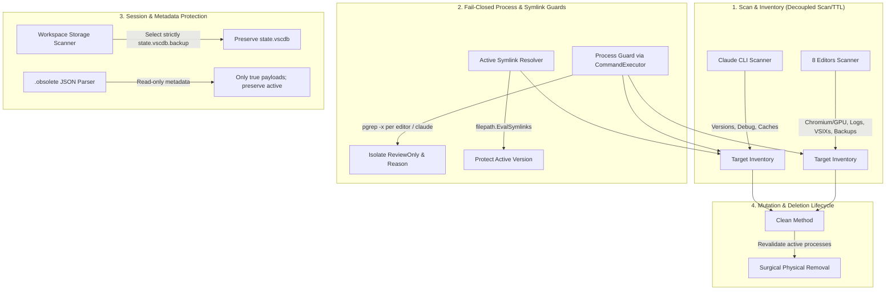
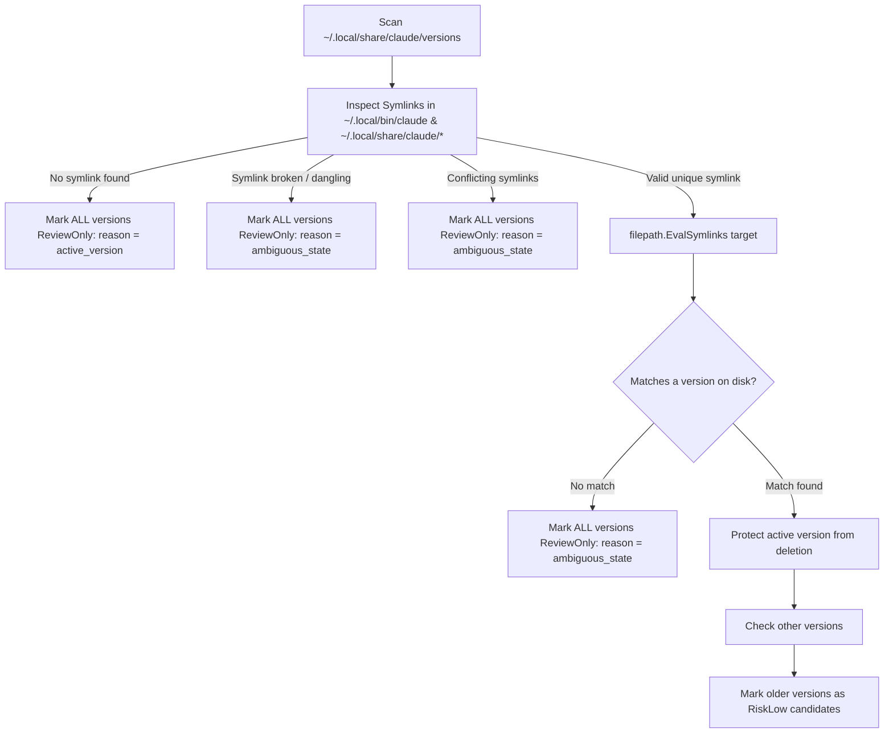
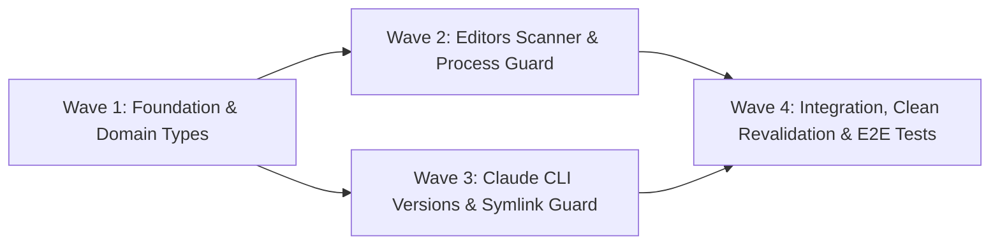

# Phase 09: AI/Electron Editors & Active Versions - Research Findings

**Research Completed:** 2026-10-15  
**Milestone:** v2.3 Functional Parity  
**Phase:** 09-ai-electron-editors-active-versions  
**Status:** Complete — Ready for Planning  
**Target File:** `.planning/phases/09-ai-electron-editors-active-versions/09-RESEARCH.md`  

---

## 1. Executive Summary & Architecture Overview

Phase 09 expands DevClean's AI and editor cleanup scope to achieve strict functional parity with Mole (Frente 2 of `SPEC-v2.3-MOLE-PARITY.md`), satisfying requirements **AI-01**, **AI-02**, and **AI-03**.

The core value proposition of DevClean is:
> *DevClean must accurately reveal reclaimable space while strictly preventing broad inventory discovery from being confused with authorization to delete shared, active, or session data.*

In this phase, that core value translates into five critical architectural pillars:



### Architectural Responsibilities by Component

1. **`internal/cleaner/ai/editors.go`**:
   - Covers 8 editors: **VS Code (`Code`)**, **VS Code Insiders (`Code - Insiders`)**, **Cursor**, **Antigravity**, **Windsurf**, **Claude Desktop (`Claude`)**, **OpenCode**, and **Zed**.
   - Identifies regenerable leaves across Chromium/Electron standard paths (`Cache`, `Code Cache`, `GPUCache`, `DawnCache`, `DawnWebGPUCache`, `DawnGraphiteCache`, `Service Worker/CacheStorage`, `Service Worker/ScriptCache`, `CachedData`, `CachedExtensionVSIXs`, `webviewCache`, `logs`, `Crashpad/completed`, `Sentry`) and native structures for Zed (GPUI) and OpenCode.
   - Consolidates targets into **3 to 4 functional groups per editor** (`Caches Chromium/GPU`, `Logs & Crashpad`, `Extensões/VSIXs`, `Workspace Backups`) per decision **D-01**, avoiding UI clutter while providing clear operational visibility.
   - Performs surgical discovery of `User/workspaceStorage/*/state.vscdb.backup` without ever touching `state.vscdb` primary databases (**D-13**).
   - Parses `.obsolete` as read-only metadata without deleting it, applying strict checks against path traversal and symlinks (**D-14**, **D-15**).

2. **`internal/cleaner/ai/claude.go`**:
   - Inventories inactive Claude Code CLI versions in `~/.local/share/claude/versions/*` and `~/.claude/local`.
   - Resolves active symlinks (`~/.local/bin/claude`, `~/.local/share/claude/current`, etc.) via `filepath.EvalSymlinks` (**D-09**).
   - Employs a strict **fail-closed** policy: if the active version symlink is missing, broken, or ambiguous, all discovered versions receive `ReviewOnly = true`, `EligibleBytes = 0`, and explicit review reasons (`ReviewReasonActiveVersion` or `ReviewReasonAmbiguous`), preventing accidental deletion while reporting accurate disk space (**D-10**).
   - Preserves existing disposable cache scanning (`debug`, `tmp`, `cache`, `telemetry`, `.log`).

3. **`internal/cleaner/ai/ai.go`**:
   - Clean architecture entry point and orchestrator for the `ai` ecosystem.
   - Accepts `cleaner.CommandExecutor` to inject hermetic mocks during unit testing (**D-05**).
   - Implements pre-deletion revalidation in `Clean()`: verifies process state immediately before unlinking physical files to defeat race conditions (**D-07**).
   - Surgically cleans virtual composite editor targets (`editor://<editor>/<category>`) and physical filesystem paths.

4. **`internal/domain/types.go`**:
   - Introduces explicit semantic review reasons:
     - `ReviewReasonActiveVersion = "active_version"`
     - `ReviewReasonAmbiguous = "ambiguous_state"`
   - Adheres to existing `ReviewReasonActiveProcess`, `ReviewReasonSessionSensitive`, etc.

---

## 2. Editor Leaves Mapping

### 2.1 The 8 Supported Editors & Platform Paths

| Editor | Process Name (`pgrep -x`) | macOS App Support / Config Path | macOS Cache Paths | Linux Config / Cache Paths | Extensions Root |
|---|---|---|---|---|---|
| **VS Code (`Code`)** | `Code` (macOS), `code` (Linux) | `~/Library/Application Support/Code` | `~/Library/Caches/com.microsoft.VSCode`, `*.ShipIt` | `~/.config/Code`, `~/.cache/Code` | `~/.vscode/extensions` |
| **VS Code Insiders** | `Code - Insiders` (macOS), `code-insiders` (Linux) | `~/Library/Application Support/Code - Insiders` | `~/Library/Caches/com.microsoft.VSCodeInsiders`, `*.ShipIt` | `~/.config/Code - Insiders`, `~/.cache/Code - Insiders` | `~/.vscode-insiders/extensions` |
| **Cursor** | `Cursor` (macOS), `cursor` (Linux) | `~/Library/Application Support/Cursor` | `~/Library/Caches/com.todesktop.230313mzl4w4u92*`, `Cursor` | `~/.config/Cursor`, `~/.cache/Cursor` | `~/.cursor/extensions` |
| **Antigravity** | `Antigravity` (macOS), `antigravity` (Linux) | `~/Library/Application Support/Antigravity`, `Antigravity IDE` | `~/Library/Caches/Antigravity`, `com.google.antigravity*` | `~/.config/Antigravity`, `~/.cache/Antigravity` | `~/.antigravity/extensions`, `~/.antigravity-ide/extensions` |
| **Windsurf** | `Windsurf` (macOS), `windsurf` (Linux) | `~/Library/Application Support/Windsurf` | `~/Library/Caches/com.exafunction.windsurf*`, `Windsurf` | `~/.config/Windsurf`, `~/.cache/Windsurf` | `~/.windsurf/extensions` |
| **Claude Desktop** | `Claude` (macOS), `claude-desktop` (Linux) | `~/Library/Application Support/Claude` | `~/Library/Caches/com.anthropic.claudefordesktop*` | `~/.config/Claude`, `~/.cache/Claude` | *(N/A)* |
| **OpenCode** | `opencode` (or `OpenCode`) | `~/Library/Application Support/opencode` (if present) | `~/Library/Caches/opencode` | `~/.config/opencode`, `~/.cache/opencode` | *(N/A)* |
| **Zed** | `zed` (or `Zed`) | *(N/A)* | `~/Library/Caches/dev.zed.Zed`, `~/Library/Logs/Zed` | `~/.cache/zed`, `~/.local/state/zed/logs` | *(N/A)* |

### 2.2 Regenerable Leaf Directories

Chromium and Electron applications maintain a predictable hierarchy of disposable caches. In accordance with Mole parity (`SPEC-v2.3-MOLE-PARITY.md` Frente 2), the following subdirectories inside each editor's base directory are classified as safe, regenerable leaves:

1. **Chromium & GPU Caches (`RiskLow`)**:
   - `Cache`: Standard HTTP/network cache.
   - `Code Cache`: V8 bytecode cache (e.g., `js`, `wasm`).
   - `GPUCache`: Compiled shaders and GPU state.
   - `DawnCache`, `DawnWebGPUCache`, `DawnGraphiteCache`: WebGPU and Graphite graphics pipeline caches.
   - `Service Worker/CacheStorage`: Service worker offline cached assets.
   - `Service Worker/ScriptCache`: Compiled scripts registered by service workers.
   - `CachedData`: VS Code/Electron core bytecode caches.
   - `webviewCache`: Embedded webview caches.
   - macOS Caches folder: `~/Library/Caches/<bundle-id>` and `*.ShipIt` updater staging.
   - Linux Caches folder: `~/.cache/<editor>`.

2. **Logs & Crash Reports (`RiskLow`)**:
   - `logs`: Application runtime session logs.
   - `Crashpad/completed`: Process crash dumps already processed.
   - `Crashpad`: Transient crash reporting structures.
   - `Sentry`: Sentry SDK error report queue.
   - Zed native logs: `~/Library/Logs/Zed` (macOS) or `~/.local/state/zed/logs` (Linux).

3. **Extensions & VSIXs (`RiskMedium`)**:
   - `CachedExtensionVSIXs`: Downloaded VSIX package installers kept in Application Support after extension installation.
   - `.obsolete` uninstalled extension folders in the editor's extension root directory.

4. **Workspace State Backups (`RiskMedium`)**:
   - `User/workspaceStorage/*/state.vscdb.backup`: Previous session backups of SQLite state databases.

### 2.3 Non-Target Protected Paths (Inviolable Invariants)

The scanner and cleaner must **NEVER** target or traverse:
- `User/workspaceStorage/*/state.vscdb`: Primary SQLite database holding active tabs, window layouts, and UI state.
- `User/workspaceStorage/*/workspace.json`: Workspace identification metadata.
- `User/settings.json`, `User/keybindings.json`, `User/snippets/`: User preferences.
- `Cookies`, `Cookies-journal`, `Local Storage`, `Session Storage`, `SharedStorage`: Authentication cookies and local state.
- Active extension folders in `extensions/` (any folder not marked `true` in `.obsolete`).
- `.obsolete`: The metadata file itself must never be removed.

---

## 3. Workspace Storage & Obsolete Extensions Integrity

### 3.1 Workspace Storage Surgical Extraction (AI-02, D-13)

VS Code and its forks (Cursor, Antigravity, Windsurf, Code Insiders) maintain workspaces under:
`<AppSupport>/User/workspaceStorage/<workspace-id>/`

Inside each workspace directory, two critical SQLite files exist:
- `state.vscdb` (The active, primary database)
- `state.vscdb.backup` (An auxiliary backup created prior to schema migrations or updates)

```
User/workspaceStorage/
  ├── 14a8b7c3d2e1/
  │   ├── state.vscdb            <-- PROTECTED! NEVER TOUCHED!
  │   ├── state.vscdb.backup     <-- CANDIDATE (RiskMedium)
  │   └── workspace.json         <-- PROTECTED!
  └── 99f0e1d2c3b4/
      ├── state.vscdb            <-- PROTECTED!
      └── workspace.json         <-- PROTECTED! (no backup present)
```

**Surgical Discovery Algorithm**:
1. Check if `<AppSupport>/User/workspaceStorage` exists.
2. Read directory entries using `os.ReadDir`.
3. For each workspace entry:
   - Ensure it is a directory (`e.IsDir()`).
   - Check `filepath.Join(workspaceDir, "state.vscdb.backup")`.
   - If `os.Stat` succeeds and it is a regular file:
     - Add its size to the workspace backup accumulator.
     - Record the file path for mutation in `Clean()`.
   - Ignore `state.vscdb` completely.

### 3.2 Obsolete Extensions Discovery & Path Traversal Safety (AI-02, D-14, D-15)

VS Code records uninstalled extensions in `<extensions-root>/.obsolete` as a JSON map:
```json
{
  "ms-python.python-2024.0.1": true,
  "golang.go-0.41.0": false,
  "eamodio.gitlens-14.0.0": true
}
```

**Integrity and Security Rules**:
1. **Metadata Only**: The `.obsolete` file must be read with `os.ReadFile` and parsed into `map[string]bool`. It is never deleted or truncated by DevClean.
2. **Positive Selection**: Only keys with value `true` are candidates for deletion. Keys with `false` or unlisted folders in `extensions/` represent active extensions and must remain untouched.
3. **Path Traversal Defense**:
   - `cleanFolder := filepath.Clean(extFolder)`
   - Reject if `cleanFolder` contains `..` or is an absolute path (`filepath.IsAbs`).
   - Verify `rel, err := filepath.Rel(extRoot, fullExtDir)`: reject if `err != nil`, `rel == "."`, or `strings.HasPrefix(rel, "..")`.
4. **Symlink Defense**:
   - Check `safety.IsSymlink(fullExtDir)`. If it is a symlink, **skip it immediately** to avoid traversing or deleting outside the extension root.
5. **Core Blacklist Defense**:
   - Check `safety.IsCoreBlacklisted(fullExtDir)`.

---

## 4. Claude CLI Active Version Preservation

### 4.1 On-Disk Layout & Symlink Resolution (AI-03, D-09)

Claude Code CLI installs self-contained versioned executables or directories and creates symlinks for invocation:
- Versions directory: `~/.local/share/claude/versions/`
  - E.g.: `2.1.299`, `2.1.300`, `2.1.301`
- Alternate local path: `~/.claude/local`
- Active invocation symlinks:
  - `~/.local/bin/claude`
  - `~/.local/share/claude/current`
  - `~/.local/share/claude/versions/current`
  - `~/.local/share/claude/claude`

### 4.2 Fail-Closed Active Version Algorithm (D-10)



**Invariant Rules**:
1. If the active symlink cannot be unambiguously resolved to a specific version on disk, DevClean **fails closed**:
   - Every discovered version target receives:
     - `ReviewOnly = true`
     - `EligibleBytes = 0`
     - `TTLEligible = false`
     - `ReviewReason = domain.ReviewReasonActiveVersion` or `domain.ReviewReasonAmbiguous`
   - Total disk space occupied is still reported accurately in `SizeBytes` (**SCAN-01**).
2. If the active version is successfully resolved:
   - The active version directory/binary is **never** added as an eligible deletion candidate.
   - Older version directories are emitted as deletion candidates with `RiskLow` (**D-12**), respecting `MaxAgeDays` TTL if configured.

---

## 5. Process Guard Implementation

### 5.1 Architecture & Injection via `cleaner.CommandExecutor` (D-05, D-08)

To maintain 100% hermetic unit testing without CGO or OS-level side effects, process detection uses `cleaner.CommandExecutor` to execute `pgrep -x`:

```go
// checkProcessStatus returns running=true if pgrep finds matching processes.
// If pgrep fails with exit code 1, running=false, uncertain=false (cleanly not running).
// If pgrep fails with any other error or missing tool, uncertain=true (FAIL CLOSED!).
func checkProcessStatus(ctx context.Context, exec cleaner.CommandExecutor, processNames ...string) (running bool, uncertain bool) {
    for _, name := range processNames {
        out, err := exec.Output(ctx, "pgrep", "-x", name)
        if err == nil && len(strings.TrimSpace(string(out))) > 0 {
            return true, false
        }
        var exitErr interface{ ExitCode() int }
        if errors.As(err, &exitErr) && exitErr.ExitCode() == 1 {
            continue // Cleanly not running for this process name
        }
        // Any unexpected error (command not found, permission, exit > 1) -> uncertain -> FAIL CLOSED!
        return false, true
    }
    return false, false
}
```

### 5.2 Per-Editor Process Mapping

| Editor | Primary Process Name | Secondary Process Names |
|---|---|---|
| Code | `Code` | `code` |
| Code Insiders | `Code - Insiders` | `code-insiders` |
| Cursor | `Cursor` | `cursor` |
| Antigravity | `Antigravity` | `antigravity` |
| Windsurf | `Windsurf` | `windsurf` |
| Claude Desktop | `Claude` | `claude-desktop` |
| OpenCode | `opencode` | `OpenCode` |
| Zed | `zed` | `Zed` |
| Claude CLI | `claude` | *(none)* |

### 5.3 Isolated Per-Editor Guard Policy (D-06)

Process Guard evaluates each editor independently:
- If `Code` is running, but `Cursor` and `Antigravity` are closed:
  - Only `Code` targets receive `ReviewOnly = true`, `ReviewReason = domain.ReviewReasonActiveProcess`, and `EligibleBytes = 0`.
  - `Cursor` and `Antigravity` targets remain eligible for cleanup with `ReviewOnly = false`.
- If `claude` CLI is running:
  - Only Claude targets (versions, caches, logs) receive `ReviewOnly = true`.

### 5.4 Pre-Deletion Revalidation in `Clean()` (D-07)

Between `Scan()` and `Clean()`, the user might open an editor or launch `claude`. To prevent data corruption during mutation:
1. `Clean(ctx, targets)` executes a real-time re-check using `checkProcessStatus(ctx, c.exec, processNames...)` for the corresponding editor before deleting its targets.
2. If the editor or CLI is now running or uncertain, `Clean()` aborts/skips deleting that target and reports a warning/returns gracefully.

---

## 6. Functional Grouping & Target Representation (D-01)

### 6.1 Target Schema & IDs

Per decision **D-01**, each editor presents **3 to 4 consolidated targets** instead of a dozen loose leaf items:

| Target Name | Target Path (Virtual URI) | Category | Risk Level | Underlying Leaves Cleaned |
|---|---|---|---|---|
| `<Editor>: Chromium & GPU Caches` | `editor://<editor-id>/chromium-cache` | `editor-chromium-cache` | `RiskLow` | `Cache`, `Code Cache`, `GPUCache`, `Dawn*`, `Service Worker/*`, `CachedData`, `webviewCache`, `~/Library/Caches/<bundle>` |
| `<Editor>: Logs & Crash Reports` | `editor://<editor-id>/logs` | `editor-logs` | `RiskLow` | `logs`, `Crashpad/completed`, `Sentry`, native Zed logs |
| `<Editor>: Cached VSIXs & Obsolete Exts` | `editor://<editor-id>/extensions` | `editor-extensions` | `RiskMedium` | `CachedExtensionVSIXs`, obsolete extension folders from `.obsolete` |
| `<Editor>: Workspace State Backups` | `editor://<editor-id>/workspace-backups` | `editor-workspace-backups` | `RiskMedium` | `User/workspaceStorage/*/state.vscdb.backup` files |

### 6.2 Virtual URI Mechanics & Deletion Safety

1. **Safety Guarantee**: Because `editor://` contains `://`, `t.IsVirtual()` returns `true`.
   - `internal/engine/ownership.go` skips `filepath.EvalSymlinks`, preventing path resolution errors on non-filesystem URIs.
   - Accidental `os.RemoveAll(t.Path)` calls by generic cleaners cannot delete parent user configuration or session directories.
2. **Surgical Execution in `aiCleaner.Clean()`**:
   - When `t.Path` begins with `editor://`, `Clean()` delegates to a specialized helper that iterates over only the authorized leaf subdirectories or `.backup` files for that specific editor.
   - For example, `editor://code/workspace-backups` searches exclusively for `User/workspaceStorage/*/state.vscdb.backup` files and unlinks only those files, leaving `state.vscdb` untouched.

---

## 7. Wave Breakdown & Dependency Analysis

To ensure smooth incremental delivery with zero test regressions, Phase 09 is broken down into four execution waves:



### Wave 1: Domain Extensions & Executor Wiring
- **Scope**:
  - Add `ReviewReasonActiveVersion = "active_version"` and `ReviewReasonAmbiguous = "ambiguous_state"` to `internal/domain/types.go`.
  - Update `internal/domain/target_test.go` and `internal/domain/types_test.go` to test new constants.
  - Enhance `internal/cleaner/ai/ai.go` constructor to accept `cleaner.CommandExecutor` (`NewWithExecutor`, `NewWithExecutorAndHome`).
  - Wire `ai.NewWithExecutor` into `internal/engine/register.go` within `RegisterDefaultCleanersWithExecutor`.

### Wave 2: Complete 8-Editor Scanner & Obsolete/Backup Protection
- **Scope**:
  - Refactor `internal/cleaner/ai/editors.go` to support all 8 editors: Code, Code Insiders, Cursor, Antigravity, Windsurf, Claude Desktop, OpenCode, Zed.
  - Implement functional grouping (D-01) into 3–4 targets per editor.
  - Implement surgical `state.vscdb.backup` scanner (AI-02, D-13).
  - Implement `.obsolete` parser with path traversal (`..`), symlink (`safety.IsSymlink`), and blacklist checks (AI-02, D-14, D-15).
  - Implement isolated Process Guard for all 8 editors using `checkProcessStatus` (D-05, D-06, D-08).

### Wave 3: Claude CLI Versions & Fail-Closed Active Symlink Guard
- **Scope**:
  - Refactor `internal/cleaner/ai/claude.go` to scan `~/.local/share/claude/versions/*` and `~/.claude/local` (AI-03).
  - Implement canonical active symlink resolution via `filepath.EvalSymlinks` (D-09).
  - Implement fail-closed handling for missing, broken, or ambiguous symlinks (D-10).
  - Implement Process Guard for `claude` CLI via `pgrep -x claude` (D-11).
  - Classify confirmed inactive versions as `RiskLow` (D-12).

### Wave 4: Mutation Lifecycle, Revalidation & Comprehensive Testing
- **Scope**:
  - Implement pre-deletion process revalidation inside `aiCleaner.Clean()` (D-07).
  - Implement surgical deletion for virtual `editor://` targets and Claude version directories.
  - Author hermetic unit tests with sentinels in `internal/cleaner/ai/editors_test.go` and `internal/cleaner/ai/claude_test.go` (`VAL-01`).
  - Verify altered-package test coverage > 85% and zero-CGO Linux/Darwin cross-compilation (`VAL-02`).

---

## 8. Validation Architecture (VAL-01, VAL-02)

### 8.1 Unit Testing Strategy & Test Matrices

All tests will run in hermetic temporary directories created with `t.TempDir()`. No real system directories or user configurations will be accessed.

#### A. Mock CommandExecutor Implementation
```go
type mockExecutor struct {
    runningProcesses   map[string]bool
    uncertainProcesses map[string]bool
    err                error
}

func (m *mockExecutor) Output(ctx context.Context, name string, args ...string) ([]byte, error) {
    if name == "pgrep" && len(args) == 2 && args[0] == "-x" {
        proc := args[1]
        if m.uncertainProcesses[proc] {
            return nil, errors.New("pgrep: fatal internal error")
        }
        if m.runningProcesses[proc] {
            return []byte("12345\n"), nil
        }
        // Process cleanly not running -> exit code 1
        return nil, &execExitError{exitCode: 1}
    }
    return nil, errors.New("command not supported")
}

func (m *mockExecutor) LookPath(file string) (string, error) {
    return "/usr/bin/" + file, nil
}
```

#### B. Test Matrix: Workspace Storage & Obsolete Extensions

| Test Case | Fixture Setup | Expected Outcome | Sentinel Assertion |
|---|---|---|---|
| `state.vscdb.backup` presence | `workspaceStorage/ws1/state.vscdb`, `workspace.json`, `state.vscdb.backup` | Target created for backups (`RiskMedium`) | `state.vscdb` and `workspace.json` remain untouched after `Clean()` |
| Active extensions protection | `extensions/active-1.0.0`, `.obsolete` with `{"other-2.0.0": true}` | Only `other-2.0.0` is targeted | `active-1.0.0` folder and files remain untouched |
| `.obsolete = false` | `extensions/keep-1.0.0`, `.obsolete` with `{"keep-1.0.0": false}` | No target created | `keep-1.0.0` remains untouched |
| Path traversal attack in `.obsolete` | `.obsolete` contains `{"../../system_file": true}` | Rejected, no target | External path never accessed |
| Symlink inside extensions | `extensions/sym-ext` -> `/etc` | Rejected via `safety.IsSymlink` | Symlink target never deleted |
| Preservation of `.obsolete` | `.obsolete` present | Extension folders deleted | `.obsolete` file remains on disk |

#### C. Test Matrix: Claude CLI Active Version

| Test Case | Fixture Setup | Expected Outcome | Failure Signal |
|---|---|---|---|
| Valid symlink | `versions/1.0`, `versions/2.0`, symlink `claude` -> `versions/2.0` | `versions/1.0` is `RiskLow` eligible; `versions/2.0` is protected | `versions/2.0` targeted -> **FAIL** |
| Missing symlink | `versions/1.0`, `versions/2.0`, no symlink | Both marked `ReviewOnly: true`, `EligibleBytes: 0`, reason `active_version` | Any eligible bytes -> **FAIL** |
| Broken symlink | `versions/1.0`, symlink points to `versions/9.9` (missing) | All marked `ReviewOnly: true`, reason `ambiguous_state` | Any eligible bytes -> **FAIL** |
| Ambiguous symlinks | Link 1 -> `1.0`, Link 2 -> `2.0` | All marked `ReviewOnly: true`, reason `ambiguous_state` | Deletion allowed -> **FAIL** |
| Claude CLI active process | Mock `pgrep -x claude` returns PID | All Claude targets `ReviewOnly = true`, reason `active_process` | Not blocked -> **FAIL** |

#### D. Test Matrix: Process Guard & Pre-Deletion Revalidation

| Test Case | Setup | Expected Outcome |
|---|---|---|
| Isolated editor block | Mock `Code` running, `Cursor` stopped | Code targets `ReviewOnly: true`; Cursor targets eligible |
| Fail-closed on missing `pgrep` | Mock returns uncertain error | All editor targets `ReviewOnly: true`, `EligibleBytes: 0` |
| Pre-deletion revalidation | Scan: `Code` stopped (eligible). Before Clean: `Code` running | Clean detects running `Code`, aborts deleting Code targets |

### 8.2 Automated Verification Commands

```bash
# 1. Run all unit tests hermetically
go test -v -race ./internal/cleaner/ai/...

# 2. Verify altered-package code coverage exceeds 85%
go test -coverprofile=coverage.out ./internal/cleaner/ai/...
go tool cover -func=coverage.out | grep total:

# 3. Verify entire repository passes tests
go test ./...

# 4. Verify zero-CGO compilation on Darwin and Linux
CGO_ENABLED=0 GOOS=darwin go build ./...
CGO_ENABLED=0 GOOS=linux go build ./...
```

---

## 9. Failure Signals & Recovery Guidance

1. **Failure Signal: `state.vscdb` modified or missing after Clean**:
   - **Root Cause**: Cleaner targeted parent workspace directory instead of strictly matching `state.vscdb.backup`.
   - **Remediation**: Check that `Clean()` filters strictly for file base `state.vscdb.backup` or uses surgical unlinking.
2. **Failure Signal: Active version in `~/.local/share/claude/versions/` deleted**:
   - **Root Cause**: `filepath.EvalSymlinks` did not resolve canonical destination before calculating eligible targets.
   - **Remediation**: Verify resolved destination path is compared using `filepath.Clean` against all candidate version paths.
3. **Failure Signal: Flaky tests on Windows / non-Unix**:
   - **Root Cause**: Relying on real `pgrep` executable or OS-specific process tables.
   - **Remediation**: Use `cleaner.CommandExecutor` mock in all unit tests.

---

## RESEARCH COMPLETE
