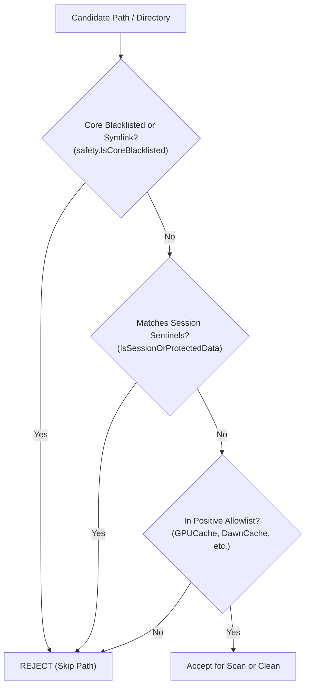
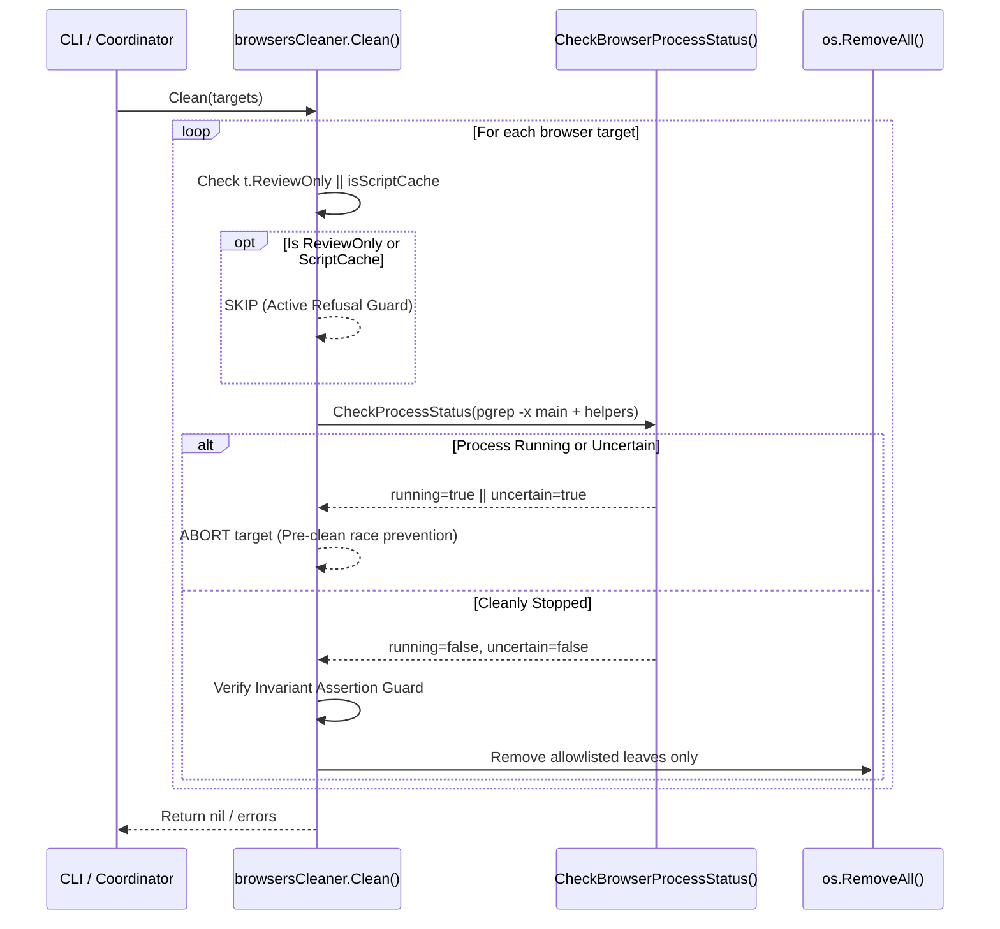

# Phase 12: Browsers, Session Exclusions & ScriptCache Gate - Research

**Date:** 2026-10-16  
**Status:** Complete  
**Requirements Covered:** `BROW-01`, `BROW-02`, `BROW-03`, `BROW-04`, `VAL-01`, `VAL-02`, `SCAN-02`, `SCAN-04`, `POL-01`, `POL-02`, `POL-04`

---

## User Constraints (from CONTEXT.md)

<user_constraints>

### Granularidade e Apresentação dos Alvos (BROW-01, BROW-02)
- **D-01:** **Agrupamento Consolidado por Navegador:** Apresentar 1 alvo consolidado principal por navegador instalado (ex: `Chrome Caches`, `Firefox Caches`, `Arc Caches`, `Edge Caches`, `Brave Caches`, `Safari Caches`), mantendo a CLI e TUI limpas e sem poluição de dezenas de linhas avulsas, alinhado ao padrão da Fase 09 para editores. — **Reversibility:** reversible — define o agrupamento e rotulação dos alvos na CLI/TUI.
- **D-02:** **Inclusão do CacheStorage no Alvo Principal do Navegador:** Incorporar o Service Worker `CacheStorage` dentro do alvo geral do navegador (`Chrome Caches`), discriminando os subvolumes de rede, GPU e CacheStorage nas métricas e detalhes do alvo sem criar alvos concorrentes elegíveis. — **Reversibility:** reversible.
- **D-03:** **Varredura Dinâmica de Todos os Perfis:** O scanner varre dinamicamente todos os diretórios de perfis existentes no disco (`Default`, `Profile *`, `System Profile` nos navegadores Chromium e todos os perfis `*.default*` no Firefox), acumulando seus bytes totais e elegíveis no alvo do respectivo navegador para garantir que perfis secundários não fiquem órfãos de limpeza. — **Reversibility:** costly — define a lógica de traversal de perfis em disco.
- **D-04:** **Abstração Unificada Multi-SO com Restrição de Plataforma:** Mapear caminhos canônicos no macOS (`~/Library/Application Support/...` e `~/Library/Caches/...`) e no Linux (`~/.config/...` e `~/.cache/...` / `~/.mozilla/...`), ativando Safari e Arc exclusivamente em Darwin e assegurando que todos os navegadores possuam testes herméticos em ambos os sistemas operacionais com zero CGO. — **Reversibility:** costly — define os caminhos e contratos de compilação multiplataforma.

### Gating e Política do ScriptCache (BROW-04)
- **D-05:** **ScriptCache Incondicionalmente ReviewOnly no v2.3:** O inventário de `Service Worker/ScriptCache` é marcado estritamente como `ReviewOnly: true`, `ReviewReason: "scriptcache_requires_evidence"`, `EligibleBytes: 0` e `TTLEligible: false`, impedindo qualquer mutação ou expurgo automático durante o milestone v2.3 até a validação integrada com evidência de aceitação na Fase 14. — **Reversibility:** costly — define o contrato de segurança do ScriptCache em conformidade com BROW-04.
- **D-06:** **Alvo Isolado de Revisão por Navegador Chromium:** Emitir alvos dedicados de revisão para o ScriptCache (ex: `Chrome ScriptCache`, `Brave ScriptCache`, `Arc ScriptCache`, `Edge ScriptCache`), permitindo que os alvos principais (`Chrome Caches`) permaneçam elegíveis quando o navegador estiver fechado sem contaminação pelo status de revisão. — **Reversibility:** reversible.
- **D-07:** **Guarda Defensiva Direta no Clean():** Além do bloqueio central no `deleter.Coordinator`, o próprio método `Clean()` do pacote `internal/cleaner/browsers` recusa e ignora imediatamente qualquer alvo marcado com `ReviewOnly == true` ou pertencente à categoria `scriptcache`, garantindo zero mutação mesmo sob chamadas diretas em testes ou refatorações. — **Reversibility:** reversible.
- **D-08:** **Emissão Estrita por Motor de Renderização:** Emitir alvos de `ScriptCache` exclusivamente para os 4 navegadores baseados em Chromium (Chrome, Brave, Arc, Edge); Firefox (Gecko) e Safari (WebKit) não emitem alvos de ScriptCache, pois suas estruturas internas de service workers permanecem protegidas pelas exclusões de sessão. — **Reversibility:** reversible.

### Process Guard e Revalidação Pré-Clean (BROW-01, BROW-04)
- **D-09:** **Bloqueio de Processo Isolado por Navegador:** A verificação de processos em execução (`pgrep -x`) é avaliada individualmente por navegador. Se o Chrome estiver aberto, apenas os alvos do Chrome recebem `ReviewOnly: true`, `ReviewReason: domain.ReviewReasonActiveProcess` e `EligibleBytes: 0`; navegadores fechados permanecem elegíveis para limpeza. — **Reversibility:** reversible.
- **D-10:** **Revalidação Atômica Pré-Clean Fail-Closed:** O método `Clean()` revalida obrigatoriamente o status dos processos do navegador imediatamente antes de executar qualquer deleção física. Se o navegador tiver sido iniciado entre o scan e a limpeza, a mutação daquele alvo é abortada atomicamente com registro explícito em log/retorno. — **Reversibility:** costly — garante integridade atômica contra condições de corrida do usuário.
- **D-11:** **Monitoramento de Processo Principal e Helpers Ativos:** O mapeamento de processos monitora tanto o binário principal (`Google Chrome`, `Brave Browser`, `Arc`, `Microsoft Edge`, `firefox`, `Safari`) quanto seus helpers ativos conhecidos (ex: `Google Chrome Helper`, `firefox-bin`), prevenindo limpeza de caches enquanto processos em background retiverem locks em disco. — **Reversibility:** reversible.
- **D-12:** **Fail-Closed em Incerteza do pgrep e Testes com MockCommandExecutor:** Qualquer falha inesperada na execução do `pgrep` (comando ausente, erro de permissão ou timeout) classifica o status como incerto (`uncertain = true`), forçando `ReviewOnly: true` e `EligibleBytes: 0`. A suite de testes utiliza `cleaner.MockCommandExecutor` para cobertura 100% determinística sem dependência de comandos do SO. — **Reversibility:** costly — padroniza o ciclo de vida hermético de processos no cleaner.

### Tratamento do Safari e Isolamento de Sessão (BROW-02, BROW-03, VAL-01)
- **D-13:** **Positive Allowlist Estrita para Safari no macOS:** O scanner do Safari varre exclusivamente as subpastas e caches regeneráveis conhecidos em `~/Library/Caches/com.apple.Safari` (`WebKitCache`, `Cache.db`), mantendo `~/Library/Safari` (histórico, favoritos, sessões) inegociavelmente fora do alcance do código. — **Reversibility:** one-way — compromisso inegociável de proteção da biblioteca privada do Safari.
- **D-14:** **Degradação Graciosa em Negação de Permissão (TCC / Full Disk Access):** Em caso de erro de acesso (`EACCES`, `EPERM` ou proteção TCC) em caches do Safari ou de outros navegadores, preencher `ProviderMetrics.Partial = true`, `StatusNote: "permission denied (TCC / Full Disk Access required)"`, marcar `ReviewOnly = true` (`ReviewReasonSystemProtected`) e operar com zero chamadas a `sudo` ou elevação de privilégio. — **Reversibility:** costly — padroniza a gestão de permissões sem elevação.
- **D-15:** **Dupla Camada de Blindagem contra Perda de Sessão (Positive + Invariant Guard):** Combinação estrutural de apontamento positivo apenas para folhas regeneráveis permitidas com uma lista de asserções negativas invioláveis (`Cookies*`, `History*`, `Local Storage*`, `IndexedDB*`, `Login Data*`, `Sessions*`, `places.sqlite*`, `key4.db*`, `logins.json*`, `sessionstore*`). Qualquer caminho que coincida com essas sentinelas de sessão é imediatamente rejeitado antes de qualquer medição ou mutação. — **Reversibility:** one-way — garantia de segurança inviolável da política BROW-03.
- **D-16:** **Fixtures Herméticos com Sentinelas Duplas em t.TempDir() (VAL-01):** Os testes unitários constroem árvores de diretórios completas para os 6 navegadores contendo arquivos descartáveis (`Cache_Data/f_000001`, `GPUCache/data_0`, `CacheStorage/...`) e sentinelas de sessão protegidas (`Cookies`, `History`, `Login Data`, `Local Storage/000003.log`, `IndexedDB/...`, `places.sqlite`, `LastSession.plist`), testando `Scan()`, `DryRun` e `Clean()` e verificando que apenas os descartáveis são removidos enquanto 100% dos dados de sessão permanecem intocados. — **Reversibility:** costly — define o contrato de testes unitários para aceitação da fase.

### the agent's Discretion
- Nomenclatura exata das constantes e funções auxiliares em `internal/cleaner/browsers/`.
- Estrutura de arquivos do novo pacote (ex: `browsers.go`, `browser_def.go`, `chromium.go`, `firefox.go`, `safari.go`, `session_guard.go`, `process.go`).
- Mapeamento exato de executáveis auxiliares e helpers por plataforma no `process.go`.

### Deferred Ideas
None — discussion stayed within phase scope.

</user_constraints>

---

## Phase Requirements Mapping

<phase_requirements>

| Requirement | Description | Research Finding & Solution |
|---|---|---|
| **BROW-01** | Chrome, Brave, Arc, Edge, Firefox, and Safari detected by on-disk presence with canonical profile/cache paths. | On-disk presence (`SCAN-02`) checks canonical paths in Darwin (`~/Library/Application Support/...` and `~/Library/Caches/...`) and Linux (`~/.config/...`, `~/.cache/...`, `~/.mozilla/...`). Arc and Safari are restricted to Darwin. Browser installation is reported if at least one profile or cache directory exists, independent of binary presence in `PATH`. |
| **BROW-02** | Consolidated presentation by browser, multi-profile traversal, aggregations (Cache_Data, GPUCache, DawnCache, Code Cache, Service Worker CacheStorage). | Single consolidated target per installed browser (`Google Chrome Caches`, `Brave Caches`, etc.) via virtual addressing (`browser://<id>/caches`). Traverses all user profiles (`Default`, `Profile *`, `System Profile`, Firefox `*.default*`), summing sizes across network cache, GPU/shaders, Code Cache, and CacheStorage. |
| **BROW-03** | Inviolable session shielding: positive allowlist + negative invariant assertion guard rejecting Cookies, History, Local Storage, IndexedDB, Login Data, Sessions, places.sqlite, etc. Safari ~/Library/Safari untouched; exclusively ~/Library/Caches/com.apple.Safari. | Dual-layer security model: 1. Positive Allowlist strictly addresses known regenerable cache subdirectories; 2. Invariant Assertion Guard validates every candidate path against session patterns (`Cookies*`, `History*`, `Login Data*`, `places.sqlite*`, `key4.db*`, `sessionstore*`, `~/Library/Safari`) and aborts immediately if matched. Safari scans strictly `~/Library/Caches/com.apple.Safari`. |
| **BROW-04** | ScriptCache gating (Chromium only): ReviewOnly: true, ReviewReason: "scriptcache_requires_evidence", EligibleBytes: 0, TTLEligible: false. Firefox & Safari do not emit ScriptCache. | Segregated target per Chromium browser (`Google Chrome ScriptCache`, `Brave ScriptCache`, etc.) with virtual path `browser://<id>/scriptcache`. Marked `ReviewOnly: true`, `ReviewReason: "scriptcache_requires_evidence"`, `EligibleBytes: 0`, and `TTLEligible: false`. `Clean()` implements an active refusal guard against any mutation of ScriptCache. Firefox and Safari emit zero ScriptCache targets. |
| **VAL-01** | Hermetic testing with zero CGO, `t.TempDir()`, double sentinels (disposable vs protected session files). | Unit tests construct full directory fixtures in `t.TempDir()` with disposable cache files alongside sensitive session files. Asserts `Scan()`, `DryRun`, and `Clean()`, proving 100% disposable removal, 100% session preservation, Process Guard mock coverage with `cleaner.MockCommandExecutor`, and zero-CGO compilation. |
| **VAL-02** | Altered package test coverage > 85%, zero-CGO Linux/Darwin builds. | Pure Go implementation without CGO. Complete test coverage of all edge cases: running processes, uncertain pgrep exit codes, permission/TCC degradation, multi-profile traversal, and symlink evasion. |

</phase_requirements>

---

## Summary

Phase 12 implements the new browser cleaner (`internal/cleaner/browsers`), delivering complete functional parity with modern system cleaners such as Mole (`tw93/mole`) while enforcing DevClean's ironclad safety boundaries:

1. **The Core Dilemma of Browser Cleaning:**
   Web browsers are among the largest generators of disposable disk waste on modern workstations—routinely consuming hundreds of megabytes to tens of gigabytes in HTTP network caches (`Cache_Data`), GPU shader caches (`GPUCache`, `DawnCache`), V8/Wasm bytecode caches (`Code Cache`), and Service Worker offline caches (`CacheStorage`). However, these caches reside directly alongside the user's most sensitive, irreplaceable personal data: active authentication cookies (`Cookies`), browsing history (`History`), saved passwords (`Login Data`), local website databases (`IndexedDB`, `Local Storage`), and open tabs/sessions (`Sessions`, `sessionstore`). A single unbounded recursive delete or naive pattern match would cause catastrophic data loss, logging the user out of every corporate and personal account and destroying browser state.

2. **Inviolable Dual-Layer Protection (`BROW-03`, `D-13`, `D-15`):**
   DevClean guarantees absolute session safety through two complementary layers:
   - **Layer 1: Structural Positive Allowlist:** The cleaner never traverses profile roots recursively. It addresses only explicitly allowlisted leaf folders (`Cache_Data`, `GPUCache`, `DawnCache`, `Code Cache`, `CacheStorage`, `WebKitCache`, `Cache.db*`).
   - **Layer 2: Negative Invariant Assertion Guard:** Before any file or directory path is measured, aggregated, or deleted, it must pass through an immutable rejection filter. Any path matching session sentinels (`Cookies*`, `History*`, `Local Storage*`, `IndexedDB*`, `Login Data*`, `Sessions*`, `places.sqlite*`, `key4.db*`, `logins.json*`, `sessionstore*`) or located within `~/Library/Safari` is immediately rejected. Both `Scan()` and `Clean()` enforce this assertion.

3. **Multi-Browser & Multi-Profile Traversal (`BROW-01`, `BROW-02`, `D-01` to `D-04`):**
   Supports six major browsers: Google Chrome, Brave, Arc, Microsoft Edge, Mozilla Firefox, and Apple Safari. Canonical paths are mapped for macOS and Linux (Arc and Safari Darwin-only). The cleaner dynamically discovers all existing profiles (`Default`, `Profile 1`, `Profile 2`, `System Profile`, Firefox `*.default*`), consolidating their cache volumes into a single, clean target per browser (`Google Chrome Caches`, `Brave Caches`, etc.) using virtual addressing (`browser://<id>/caches`).

4. **ScriptCache Gating Contract (`BROW-04`, `D-05` to `D-08`):**
   Service Worker `ScriptCache` stores compiled JavaScript/WebAssembly bytecode for offline web applications and Manifest V3 (MV3) browser extension service workers. To prevent subtle extension breakages or offline data corruption, Chromium `ScriptCache` is segregated into a dedicated review target (`Chrome ScriptCache`), marked strictly as `ReviewOnly: true`, `ReviewReason: "scriptcache_requires_evidence"`, `EligibleBytes: 0`, and `TTLEligible: false`. It cannot be deleted in v2.3 until Phase 14 integrated acceptance evidence validates offline recovery. The `Clean()` method enforces an active guard refusing to mutate any ScriptCache target. Firefox and Safari do not emit ScriptCache.

5. **Per-Browser Process Guard & Fail-Closed Pre-Clean Revalidation (`D-09` to `D-12`):**
   Active browsers hold disk locks on their cache databases (SQLite and LevelDB), causing corruption if files are unlinked while the browser is running. DevClean uses `cleaner.CommandExecutor` with `pgrep -x` to verify the execution state of the main browser binary and active helper processes (`Google Chrome Helper`, `firefox-bin`, etc.). The check is strictly isolated per browser: an active Chrome does not block cleaning of a closed Firefox. In `Clean()`, the cleaner performs an atomic pre-clean revalidation immediately before deletion; if a browser was launched after the scan, cleaning of that browser is aborted fail-closed. Any unexpected error in `pgrep` (non-zero/non-one exit code) is classified as uncertain (`uncertain = true`) and fails closed.

6. **TCC Degradation and Zero-Sudo Policy (`D-14`):**
   Accessing Safari caches or protected user containers on macOS can encounter Transparency, Consent, and Control (TCC) or permission denials (`EACCES`/`EPERM`). The cleaner catches these errors gracefully, populating `ProviderMetrics.Partial = true`, setting `StatusNote: "permission denied (TCC / Full Disk Access required)"`, marking the target `ReviewOnly: true` (`ReviewReasonSystemProtected`), and never attempting to elevate via `sudo`.

7. **Canonical Deduplication with Generic macOS Cleaner (`SCAN-04`):**
   To prevent duplicate byte counting between the new `browsers` cleaner and the generic `macos` user cleaner (`internal/cleaner/macos/user.go`), browser directories in `~/Library/Caches` (`Google`, `BraveSoftware`, `company.thebrowser.Arc`, `Microsoft Edge`, `Firefox`, `com.apple.Safari`) are formally registered in the exclusion table of `user.go`.

---

## Architectural Responsibility Map

| Component / Submodule | Specific Responsibility in Phase 12 |
|---|---|
| `internal/cleaner/browsers/browsers.go` | Entrypoint implementing `domain.Cleaner` (`Name() = "browsers"`, `IsInstalled()`, `Scan()`, `Clean()`). Orchestrates per-browser scanning, error aggregation, and fail-closed deletion. |
| `internal/cleaner/browsers/browser_def.go` | Declarative definitions for the 6 browsers: IDs (`chrome`, `brave`, `arc`, `edge`, `firefox`, `safari`), human names, platform restrictions (`darwinOnly`), process names (Darwin & Linux), and profile/cache root resolver functions. |
| `internal/cleaner/browsers/session_guard.go` | Inviolable positive allowlist and negative invariant assertion guard (`D-13`, `D-15`). Validates candidate paths against session patterns (`Cookies*`, `History*`, `places.sqlite*`, etc.) and system blacklists (`safety.IsCoreBlacklisted`). |
| `internal/cleaner/browsers/process.go` | Per-browser process verification using `cleaner.CommandExecutor` (`pgrep -x`) (`D-09` to `D-12`). Checks main executables and helper processes. Returns `running` and `uncertain` with fail-closed semantics. |
| `internal/cleaner/browsers/chromium.go` | Scanner for Chromium-based browsers (Chrome, Brave, Arc, Edge). Discovers all profiles (`Default`, `Profile *`, etc.), aggregates allowlisted cache subfolders (`GPUCache`, `DawnCache`, `Code Cache`, `CacheStorage`, `Cache_Data`), and extracts `ScriptCache` into dedicated review targets (`D-02`, `D-03`, `D-05`, `D-06`). |
| `internal/cleaner/browsers/firefox.go` | Scanner for Mozilla Firefox (Gecko). Discovers profiles (`*.default*`), aggregates allowlisted cache folders (`cache2`, `startupCache`, `jumpListCache`, `thumbnails`), and ensures zero session file exposure (`places.sqlite`, `key4.db`). Emits zero ScriptCache (`D-08`). |
| `internal/cleaner/browsers/safari.go` | Scanner for Apple Safari (WebKit, Darwin only) (`D-13`, `D-14`). Strictly scans allowlisted subfolders in `~/Library/Caches/com.apple.Safari` (`WebKitCache`, `Cache.db*`). Handles TCC/permission degradation via `ProviderMetrics.Partial = true`. Leaves `~/Library/Safari` completely untouched. Emits zero ScriptCache (`D-08`). |
| `internal/cleaner/browsers/browsers_test.go` | Hermetic unit tests with `t.TempDir()`, `MockCommandExecutor`, double sentinels (disposable cache vs protected session), `DryRun` validation, running browser abortion, pre-clean revalidation, and TCC simulation (`VAL-01`, `VAL-02`). |
| `internal/cleaner/macos/user.go` | Updates `dedicatedEcosystemCaches` to exclude browser cache directories (`Google`, `BraveSoftware`, `company.thebrowser.Arc`, `Microsoft Edge`, `Firefox`, `com.apple.Safari`) from generic macOS user cache scanning (`SCAN-04`). |
| `internal/config/config.go` & `defaults.go` | Registers `Browsers EcosystemConfig` and `Browsers HookConfig` in `EcosystemsConfig` and `HooksConfig` with default `MaxAgeDays: 14`. |
| `internal/engine/register.go` | Registers `browsers.NewWithExecutor(exec)` in `RegisterDefaultCleanersWithExecutor`. |
| `internal/engine/engine.go` | Wires `"browsers"` in `ecosystemConfig(name string)` to `e.config.Ecosystems.Browsers`. |

---

## Standard Stack

- **Go 1.25 Standard Library:**
  - `path/filepath`: `filepath.Join`, `filepath.Clean`, `filepath.Rel`, `filepath.EvalSymlinks`, `filepath.WalkDir`, `filepath.Base`.
  - `os`: `os.ReadDir`, `os.RemoveAll`, `os.Lstat`, `os.Stat`, `os.UserHomeDir`, `os.IsPermission`.
  - `strings`: Prefix, suffix, contains, and path component tokenization.
  - `context`: Propagation of cancellation during scan and clean.
  - `time`: Profile modification times and cutoff calculations.
  - `errors`, `fmt`: Structured error handling and formatting.
  - `runtime`: `runtime.GOOS` platform detection.
- **DevClean Core Primitives:**
  - `cleaner.CommandExecutor` / `cleaner.MockCommandExecutor`: Testable execution of `pgrep -x` without CGO or shell dependencies.
  - `domain.Target` / `domain.ProviderMetrics`: Contract for target attributes, review metadata, and partial degradation reporting.
  - `domain.ReviewReasonActiveProcess`, `domain.ReviewReasonSystemProtected`: Standard semantic review reasons.
  - `safety.IsCoreBlacklisted`, `safety.IsSymlink`: Prevention of root directory deletion and symlink traversal escapes.
  - `devfs.CalcDirSize`, `fs.CalcUsage`: Inode-aware and block-accurate directory size calculations.

---

## Package Legitimacy Audit

**Zero new external packages are required.**

All necessary functionality is provided by the Go 1.25 standard library and DevClean's existing internal packages (`cleaner`, `domain`, `fs`, `safety`). Process querying uses the existing `cleaner.CommandExecutor` interface wrapping `/usr/bin/pgrep`, maintaining pure Go compilation with `CGO_ENABLED=0`.

---

## Architecture Patterns

### 1. Canonical Directory Resolution per Browser and Platform (`BROW-01`, `D-04`)

| Browser | OS | Profile / App Support Root | Cache / Network Root | Process Names (`pgrep -x`) |
|---|---|---|---|---|
| **Google Chrome** | macOS | `~/Library/Application Support/Google/Chrome` | `~/Library/Caches/Google/Chrome` | `Google Chrome`, `Google Chrome Helper` |
| | Linux | `~/.config/google-chrome` | `~/.cache/google-chrome` | `chrome`, `google-chrome`, `google-chrome-stable` |
| **Brave** | macOS | `~/Library/Application Support/BraveSoftware/Brave-Browser` | `~/Library/Caches/BraveSoftware/Brave-Browser` | `Brave Browser`, `Brave Browser Helper` |
| | Linux | `~/.config/BraveSoftware/Brave-Browser` | `~/.cache/BraveSoftware/Brave-Browser` | `brave`, `brave-browser` |
| **Arc** | macOS | `~/Library/Application Support/Arc/User Data` | `~/Library/Caches/company.thebrowser.Arc` | `Arc`, `Arc Helper` |
| | Linux | *Unsupported* | *Unsupported* | *N/A* |
| **Microsoft Edge** | macOS | `~/Library/Application Support/Microsoft Edge` | `~/Library/Caches/Microsoft Edge` | `Microsoft Edge`, `Microsoft Edge Helper` |
| | Linux | `~/.config/microsoft-edge` | `~/.cache/microsoft-edge` | `msedge`, `microsoft-edge` |
| **Mozilla Firefox**| macOS | `~/Library/Application Support/Firefox/Profiles` | `~/Library/Caches/Firefox/Profiles` | `firefox`, `firefox-bin` |
| | Linux | `~/.mozilla/firefox` | `~/.cache/mozilla/firefox` | `firefox`, `firefox-bin` |
| **Apple Safari** | macOS | *Untouched (`~/Library/Safari` EXCLUDED)* | `~/Library/Caches/com.apple.Safari` | `Safari`, `SafariTechnologyPreview` |
| | Linux | *Unsupported* | *Unsupported* | *N/A* |

### 2. Multi-Profile Traversal Engine (`BROW-02`, `D-03`)

Chromium browsers store profiles as subdirectories under their Application Support / Config root. A user workstation frequently has multiple active profiles (e.g. `Default`, `Profile 1` for work, `Profile 2` for personal, and `System Profile`).

- **Chromium Profile Identification:**
  A subdirectory in the Chromium App Support root is recognized as a profile if:
  1. The name is `Default`, `System Profile`, `Guest Profile`, OR
  2. The name matches the pattern `Profile *` (e.g. `Profile 1`, `Profile 2`), OR
  3. The directory contains a `Preferences` file.
- **Cache Mirroring:**
  In macOS, Chromium mirrors profile cache paths under `~/Library/Caches/<Browser>/<Profile>/` (e.g. `Cache_Data`, `Media Cache`, `Code Cache`). The traversal engine joins both profile App Support directories and their matching Caches subdirectories, calculating cumulative size.
- **Firefox Profile Identification:**
  Under `~/Library/Application Support/Firefox/Profiles` (or `~/.mozilla/firefox`), Firefox creates directories named `<random>.<name>` (e.g. `7x8y9z.default-release`). Caches are mirrored under `~/Library/Caches/Firefox/Profiles/<random>.<name>/`. The scanner matches these profile directories and inspects only regenerable cache leaves.

### 3. Dual-Layer Inviolable Session Shielding (`BROW-03`, `D-13`, `D-15`)



The session sentinel matcher checks every candidate path component and base name against immutable patterns:
- `Cookies*`, `Cookies-journal`
- `History*`, `History-journal`
- `Login Data*`, `Login Data-journal`
- `Web Data*`, `Web Data-journal`
- `Local Storage*`
- `IndexedDB*`
- `Sessions*`, `Current Session`, `Current Tabs`, `Last Session`, `Last Tabs`
- `Bookmarks*`, `Preferences*`, `Secure Preferences*`
- `places.sqlite*`, `key4.db*`, `logins.json*`, `sessionstore*`
- `favicons.sqlite*`, `formhistory.sqlite*`
- `~/Library/Safari` (any path under Safari's private library)

If ANY pattern matches, the path is dropped immediately.

### 4. Target Consolidation and Virtual Addressing (`D-01`, `D-02`, `D-06`)

To prevent CLI/TUI clutter from dozens of individual profile leaf rows, DevClean aggregates targets per browser:
- **Main Cache Target:**
  - Name: `<Browser Name> Caches` (e.g. `Chrome Caches`, `Firefox Caches`, `Safari Caches`)
  - Virtual Path: `browser://<id>/caches`
  - Includes: `Cache_Data` (HTTP cache), `GPUCache`, `DawnCache`, `Code Cache`, and `Service Worker/CacheStorage`.
  - Status: Eligible for deletion when the browser is stopped and within TTL rules.
- **ScriptCache Target (Chromium only):**
  - Name: `<Browser Name> ScriptCache` (e.g. `Chrome ScriptCache`, `Brave ScriptCache`)
  - Virtual Path: `browser://<id>/scriptcache`
  - Status: `ReviewOnly: true`, `ReviewReason: "scriptcache_requires_evidence"`, `EligibleBytes: 0`, `TTLEligible: false`.

Because the path uses the virtual URI scheme `browser://`, `target.IsVirtual()` returns `true`. In the `deleter.Coordinator`, virtual targets bypass filesystem quarantine/trash and are dispatched directly to `cleaner.Clean()`, where surgical, process-revalidated removal is performed.

### 5. Atomic Pre-Clean Process Guard (`D-09`, `D-10`, `D-11`, `D-12`)



- **Scan Phase:** Evaluates running processes. If active or uncertain, target receives `ReviewOnly: true`, `ReviewReasonActiveProcess`, and `EligibleBytes: 0`.
- **Clean Phase:** Re-evaluates running processes immediately prior to deleting. If the browser was launched between scan and clean, mutation of that browser's targets is aborted fail-closed.
- **Fail-Closed on Uncertainty:** Exit code 1 from `pgrep` indicates 0 matching processes (cleanly stopped). Exit code 0 indicates matching processes (running). Any other exit code or execution error is uncertain (`uncertain = true`), which triggers fail-closed retention.

### 6. Graceful Degradation under TCC / Permission Denials (`D-14`)

On macOS, directory entries under `~/Library/Caches/com.apple.Safari` or sandboxed browser containers may return `os.ErrPermission`, `syscall.EACCES`, or `syscall.EPERM` when Full Disk Access is not granted.
- The cleaner traps permission errors during traversal.
- It records whatever bytes could be read.
- It attaches `domain.ProviderMetrics`:
  ```go
  trg.ProviderMetrics = &domain.ProviderMetrics{
      Partial:    true,
      StatusNote: "permission denied (TCC / Full Disk Access required)",
  }
  trg.ReviewOnly = true
  trg.ReviewReason = domain.ReviewReasonSystemProtected
  trg.EligibleBytes = 0
  trg.TTLEligible = false
  ```
- **Zero Sudo:** DevClean strictly never calls `sudo` or requests privilege elevation.

---

## Don't Hand-Roll

| Problem | Anti-Pattern (Don't Do This) | Standard Primitive (Do This) |
|---|---|---|
| Directory Size & Usage | Writing manual recursive file stat loops ignoring sparse files or block sizes. | Use `devfs.CalcDirSize(path)` (`internal/fs/size.go`) or `fs.CalcUsage(path)` (`internal/fs/usage.go`). |
| Process Checking | Spawning `/bin/sh -c "ps aux \| grep ..."` or using CGO `libproc`. | Use `cleaner.CommandExecutor` with `exec.Output(ctx, "pgrep", "-x", name)` and parse exit codes. |
| Test Process Mocking | Relying on real OS processes or sleeping in unit tests. | Use `cleaner.NewMockExecutor()` / `cleaner.MockCommandExecutor` to configure deterministic outputs and exit errors. |
| Symlink Detection & Escapes | Manually comparing string paths without resolving real symlinks. | Use `os.Lstat` followed by `filepath.EvalSymlinks` and `safety.IsSymlink(path)`. |
| System Blacklist Protection | Hardcoding ad-hoc checks for `/` or `/etc`. | Call `safety.IsCoreBlacklisted(path)` (`internal/safety/blacklist.go`). |
| Session File Filtering | Trying to wipe the entire profile folder and selectively recreating session files. | Use surgical allowlists pointing ONLY to designated cache subfolders, verified with `IsSessionOrProtectedData`. |

---

## Common Pitfalls

### 1. Deleting Browser Session Data (The "Nuclear" Risk)
- **Pitfall:** Using broad directory sweeps (e.g. `os.RemoveAll(profileDir)` with exclusion filters). If an error occurs during recreation or an unexpected session file exists (e.g. `Network Persistent State`, `Web Data-journal`, SQLite WAL files), the user's login tokens and passwords are destroyed.
- **Prevention:** Structural Positive Allowlist. The cleaner never deletes a profile directory or walks arbitrary files. It explicitly constructs target paths for only known cache leaves (`GPUCache`, `DawnCache`, `Code Cache`, `CacheStorage`, `Cache_Data`), and re-asserts `IsSessionOrProtectedData(path) == false` before unlinking.

### 2. Touching `~/Library/Safari`
- **Pitfall:** Assuming Safari's caches are in `~/Library/Safari/Caches` or scanning `~/Library/Safari`. `~/Library/Safari` contains History.db, Bookmarks.plist, CloudTabs, ReadingList, and sensitive iCloud sync state.
- **Prevention:** D-13 rule: `~/Library/Safari` is unconditionally blacklisted in `IsSessionOrProtectedData`. The Safari scanner interacts exclusively with `~/Library/Caches/com.apple.Safari`.

### 3. Cleaning Active Browsers (Disk Lock Contention)
- **Pitfall:** Unlinking LevelDB/SQLite cache files while Chromium, Firefox, or Safari has open file descriptors. This results in database corruption, stale locks (`LOCK` file remaining in LevelDB), and browser crashes.
- **Prevention:** Process Guard queries `pgrep -x` for both the main executable and helper processes (`Google Chrome Helper`, `firefox-bin`). If active, the target is blocked from automatic cleaning (`ReviewOnly: true`, `ReviewReasonActiveProcess`).

### 4. Race Condition: Browser Started After Scan
- **Pitfall:** A scan is run while Chrome is closed (marking `Chrome Caches` eligible). While the user reviews the results in CLI/TUI, they open Chrome. The subsequent `Clean()` call deletes files from under the now-active browser.
- **Prevention:** D-10 rule: `Clean()` performs an atomic pre-clean revalidation of `pgrep -x` immediately before unlinking files. If the browser launched post-scan, cleaning is aborted fail-closed for that browser.

### 5. ScriptCache Accidental Mutation
- **Pitfall:** Grouping `ScriptCache` into the main cache target or deleting it under automatic cleanup, breaking Manifest V3 extensions or offline web app workers.
- **Prevention:** D-05 to D-08 rules: Chromium `ScriptCache` is strictly emitted as a separate target with `ReviewOnly: true`, `ReviewReason: "scriptcache_requires_evidence"`, and `EligibleBytes: 0`. Furthermore, `Clean()` contains a defensive assertion that skips any target with `ReviewOnly == true` or category `browser-scriptcache`.

### 6. Symlink Path Traversal & Escapes
- **Pitfall:** A cache folder is replaced with a symlink pointing to `$HOME` or `/etc`.
- **Prevention:** Before unlinking or scanning, `os.Lstat` verifies the entry is not a symlink. If it is a symlink, it is verified with `filepath.EvalSymlinks` to ensure it does not point outside the designated cache root or to blacklisted roots (`safety.IsCoreBlacklisted`).

### 7. TCC Access Errors Crashing Scan
- **Pitfall:** Calling `os.ReadDir` on `~/Library/Caches/com.apple.Safari` on macOS without Full Disk Access causes a runtime error, terminating the scan engine.
- **Prevention:** D-14 rule: Permission errors are caught, returning partial metrics (`ProviderMetrics.Partial = true`, `StatusNote: "permission denied (TCC / Full Disk Access required)"`) and marking the target `ReviewOnly: true` (`ReviewReasonSystemProtected`).

### 8. Double-Counting Between `macos` and `browsers` Cleaners
- **Pitfall:** Both the generic macOS user cleaner (`internal/cleaner/macos/user.go`) and the `browsers` cleaner scan `~/Library/Caches/Google/Chrome`, causing double byte accounting in violation of `SCAN-04`.
- **Prevention:** Register browser directories (`Google`, `BraveSoftware`, `company.thebrowser.Arc`, `Microsoft Edge`, `Firefox`, `com.apple.Safari`) in `dedicatedEcosystemCaches` in `internal/cleaner/macos/user.go`.

### 9. CGO Leakage
- **Pitfall:** Importing `os/user` or native macOS APIs requiring CGO, breaking pure Go cross-compilation (`CGO_ENABLED=0`).
- **Prevention:** Stick strictly to Go standard library packages and `cleaner.CommandExecutor` without CGO bindings.

---

## Code Examples

### 1. Browser Definition Structure (`browser_def.go`)

```go
package browsers

import (
	"path/filepath"
	"runtime"
)

type BrowserDef struct {
	ID            string
	Name          string
	DarwinOnly    bool
	ProcessNames  map[string][]string // "darwin" -> [...], "linux" -> [...]
	AppSupportDir func(home string, goos string) string
	CacheDir      func(home string, goos string) string
	HasScriptCache bool
}

func GetBrowserDefinitions() []BrowserDef {
	return []BrowserDef{
		{
			ID:         "chrome",
			Name:       "Google Chrome",
			DarwinOnly: false,
			ProcessNames: map[string][]string{
				"darwin": {"Google Chrome", "Google Chrome Helper"},
				"linux":  {"chrome", "google-chrome", "google-chrome-stable"},
			},
			AppSupportDir: func(home, goos string) string {
				if goos == "darwin" {
					return filepath.Join(home, "Library", "Application Support", "Google", "Chrome")
				}
				return filepath.Join(home, ".config", "google-chrome")
			},
			CacheDir: func(home, goos string) string {
				if goos == "darwin" {
					return filepath.Join(home, "Library", "Caches", "Google", "Chrome")
				}
				return filepath.Join(home, ".cache", "google-chrome")
			},
			HasScriptCache: true,
		},
		{
			ID:         "brave",
			Name:       "Brave",
			DarwinOnly: false,
			ProcessNames: map[string][]string{
				"darwin": {"Brave Browser", "Brave Browser Helper"},
				"linux":  {"brave", "brave-browser"},
			},
			AppSupportDir: func(home, goos string) string {
				if goos == "darwin" {
					return filepath.Join(home, "Library", "Application Support", "BraveSoftware", "Brave-Browser")
				}
				return filepath.Join(home, ".config", "BraveSoftware", "Brave-Browser")
			},
			CacheDir: func(home, goos string) string {
				if goos == "darwin" {
					return filepath.Join(home, "Library", "Caches", "BraveSoftware", "Brave-Browser")
				}
				return filepath.Join(home, ".cache", "BraveSoftware", "Brave-Browser")
			},
			HasScriptCache: true,
		},
		{
			ID:         "arc",
			Name:       "Arc",
			DarwinOnly: true,
			ProcessNames: map[string][]string{
				"darwin": {"Arc", "Arc Helper"},
			},
			AppSupportDir: func(home, goos string) string {
				if goos != "darwin" {
					return ""
				}
				return filepath.Join(home, "Library", "Application Support", "Arc", "User Data")
			},
			CacheDir: func(home, goos string) string {
				if goos != "darwin" {
					return ""
				}
				return filepath.Join(home, "Library", "Caches", "company.thebrowser.Arc")
			},
			HasScriptCache: true,
		},
		{
			ID:         "edge",
			Name:       "Microsoft Edge",
			DarwinOnly: false,
			ProcessNames: map[string][]string{
				"darwin": {"Microsoft Edge", "Microsoft Edge Helper"},
				"linux":  {"msedge", "microsoft-edge"},
			},
			AppSupportDir: func(home, goos string) string {
				if goos == "darwin" {
					return filepath.Join(home, "Library", "Application Support", "Microsoft Edge")
				}
				return filepath.Join(home, ".config", "microsoft-edge")
			},
			CacheDir: func(home, goos string) string {
				if goos == "darwin" {
					return filepath.Join(home, "Library", "Caches", "Microsoft Edge")
				}
				return filepath.Join(home, ".cache", "microsoft-edge")
			},
			HasScriptCache: true,
		},
		{
			ID:         "firefox",
			Name:       "Mozilla Firefox",
			DarwinOnly: false,
			ProcessNames: map[string][]string{
				"darwin": {"firefox", "firefox-bin"},
				"linux":  {"firefox", "firefox-bin"},
			},
			AppSupportDir: func(home, goos string) string {
				if goos == "darwin" {
					return filepath.Join(home, "Library", "Application Support", "Firefox", "Profiles")
				}
				return filepath.Join(home, ".mozilla", "firefox")
			},
			CacheDir: func(home, goos string) string {
				if goos == "darwin" {
					return filepath.Join(home, "Library", "Caches", "Firefox", "Profiles")
				}
				return filepath.Join(home, ".cache", "mozilla", "firefox")
			},
			HasScriptCache: false,
		},
		{
			ID:         "safari",
			Name:       "Safari",
			DarwinOnly: true,
			ProcessNames: map[string][]string{
				"darwin": {"Safari", "SafariTechnologyPreview"},
			},
			AppSupportDir: func(home, goos string) string {
				return "" // Strictly NO AppSupport inspection!
			},
			CacheDir: func(home, goos string) string {
				if goos != "darwin" {
					return ""
				}
				return filepath.Join(home, "Library", "Caches", "com.apple.Safari")
			},
			HasScriptCache: false,
		},
	}
}
```

### 2. Inviolable Session Guard (`session_guard.go`)

```go
package browsers

import (
	"path/filepath"
	"strings"

	"github.com/gtkpad/devclean/internal/safety"
)

var protectedSessionTokens = []string{
	"cookies",
	"history",
	"login data",
	"web data",
	"local storage",
	"indexeddb",
	"sessions",
	"current session",
	"current tabs",
	"last session",
	"last tabs",
	"bookmarks",
	"preferences",
	"secure preferences",
	"places.sqlite",
	"key4.db",
	"logins.json",
	"sessionstore",
	"favicons.sqlite",
	"formhistory.sqlite",
	"lastsession.plist",
}

// IsSessionOrProtectedData returns true if the path contains or matches any session,
// history, password, or protected personal data token.
func IsSessionOrProtectedData(path string) bool {
	clean := filepath.Clean(path)
	if safety.IsCoreBlacklisted(clean) {
		return true
	}

	// Inviolable Safari private directory shield (D-13)
	lower := strings.ToLower(clean)
	if strings.Contains(lower, filepath.Join("library", "safari")) {
		return true
	}

	// Match individual path components and base name
	base := strings.ToLower(filepath.Base(clean))
	for _, tok := range protectedSessionTokens {
		if strings.HasPrefix(base, tok) || base == tok {
			return true
		}
	}

	parts := strings.FieldsFunc(lower, func(r rune) bool {
		return r == '/' || r == '\\'
	})
	for _, part := range parts {
		for _, tok := range protectedSessionTokens {
			if part == tok || strings.HasPrefix(part, tok) {
				return true
			}
		}
	}

	return false
}
```

### 3. Process Guard (`process.go`)

```go
package browsers

import (
	"context"
	"errors"
	"strings"

	"github.com/gtkpad/devclean/internal/cleaner"
)

// CheckBrowserProcessStatus returns running=true if pgrep finds matching processes.
// If pgrep fails with exit code 1, running=false, uncertain=false (cleanly stopped).
// Any other exit code or execution error returns uncertain=true (FAIL CLOSED!).
func CheckBrowserProcessStatus(ctx context.Context, exec cleaner.CommandExecutor, bDef BrowserDef, goos string) (running bool, uncertain bool) {
	if exec == nil {
		return false, true
	}
	names := bDef.ProcessNames[goos]
	if len(names) == 0 {
		return false, false
	}

	for _, name := range names {
		out, err := exec.Output(ctx, "pgrep", "-x", name)
		if err == nil && len(strings.TrimSpace(string(out))) > 0 {
			return true, false
		}
		var exitErr interface{ ExitCode() int }
		if errors.As(err, &exitErr) && exitErr.ExitCode() == 1 {
			continue // cleanly stopped for this process name
		}
		// Unexpected error (pgrep missing, exit code > 1, permission error) -> FAIL CLOSED
		return false, true
	}
	return false, false
}
```

### 4. Cleaner Orchestration (`browsers.go`)

```go
package browsers

import (
	"context"
	"crypto/sha256"
	"encoding/hex"
	"fmt"
	"os"
	"path/filepath"
	"runtime"
	"strings"

	"github.com/gtkpad/devclean/internal/cleaner"
	"github.com/gtkpad/devclean/internal/domain"
	"github.com/gtkpad/devclean/internal/safety"
)

type browsersCleaner struct {
	exec    cleaner.CommandExecutor
	homeDir string
	goos    string
}

func New() domain.Cleaner {
	return NewWithExecutor(&cleaner.DefaultExecutor{})
}

func NewWithExecutor(exec cleaner.CommandExecutor) domain.Cleaner {
	home, _ := os.UserHomeDir()
	return &browsersCleaner{
		exec:    exec,
		homeDir: home,
		goos:    runtime.GOOS,
	}
}

func NewWithDirAndExecutor(homeDir string, exec cleaner.CommandExecutor) domain.Cleaner {
	return &browsersCleaner{
		exec:    exec,
		homeDir: homeDir,
		goos:    runtime.GOOS,
	}
}

func (c *browsersCleaner) Name() string {
	return "browsers"
}

func (c *browsersCleaner) IsInstalled() bool {
	for _, bDef := range GetBrowserDefinitions() {
		if bDef.DarwinOnly && c.goos != "darwin" {
			continue
		}
		if bDef.AppSupportDir != nil {
			if p := bDef.AppSupportDir(c.homeDir, c.goos); p != "" {
				if _, err := os.Stat(p); err == nil {
					return true
				}
			}
		}
		if bDef.CacheDir != nil {
			if p := bDef.CacheDir(c.homeDir, c.goos); p != "" {
				if _, err := os.Stat(p); err == nil {
					return true
				}
			}
		}
	}
	return false
}

func (c *browsersCleaner) Scan(ctx context.Context, rules domain.EcosystemRules) ([]domain.Target, error) {
	if !rules.Enabled {
		return nil, nil
	}

	var allTargets []domain.Target
	cutoff := time.Now().AddDate(0, 0, -rules.MaxAgeDays)

	for _, bDef := range GetBrowserDefinitions() {
		if bDef.DarwinOnly && c.goos != "darwin" {
			continue
		}
		if err := ctx.Err(); err != nil {
			return nil, err
		}

		running, uncertain := CheckBrowserProcessStatus(ctx, c.exec, bDef, c.goos)
		isProcessBlocked := running || uncertain

		switch bDef.ID {
		case "safari":
			targets, err := scanSafari(ctx, c.homeDir, bDef, isProcessBlocked, cutoff, rules.MaxAgeDays)
			if err == nil {
				allTargets = append(allTargets, targets...)
			}
		case "firefox":
			targets, err := scanFirefox(ctx, c.homeDir, c.goos, bDef, isProcessBlocked, cutoff, rules.MaxAgeDays)
			if err == nil {
				allTargets = append(allTargets, targets...)
			}
		default: // Chromium browsers: chrome, brave, arc, edge
			targets, err := scanChromiumBrowser(ctx, c.homeDir, c.goos, bDef, isProcessBlocked, cutoff, rules.MaxAgeDays)
			if err == nil {
				allTargets = append(allTargets, targets...)
			}
		}
	}

	return allTargets, nil
}

func (c *browsersCleaner) Clean(ctx context.Context, targets []domain.Target) error {
	for _, t := range targets {
		if err := ctx.Err(); err != nil {
			return err
		}

		// Stage 1: Defensive assertion against ReviewOnly & ScriptCache (D-05, D-07)
		if t.ReviewOnly || t.Category == "browser-scriptcache" || strings.HasSuffix(t.Path, "/scriptcache") {
			continue // Inviolable refusal guard
		}

		// Resolve browser ID from virtual path (browser://<id>/caches)
		browserID := extractBrowserIDFromURI(t.Path)
		bDef, ok := findBrowserDef(browserID)
		if !ok {
			continue
		}

		// Stage 2: Pre-deletion atomic process revalidation (D-10)
		running, uncertain := CheckBrowserProcessStatus(ctx, c.exec, bDef, c.goos)
		if running || uncertain {
			continue // Abort if browser launched post-scan (fail-closed)
		}

		// Stage 3: Surgical removal of allowlisted leaves
		if err := cleanBrowserTarget(c.homeDir, c.goos, bDef); err != nil {
			return fmt.Errorf("cleaning browser %s: %w", bDef.Name, err)
		}
	}
	return nil
}
```

---

## Validation Architecture

### Nyquist Validation Framework

- **Target Package:** `internal/cleaner/browsers`
- **Execution Command:** `go test -v ./internal/cleaner/browsers/...`
- **Zero-CGO Verification:** `CGO_ENABLED=0 go test -v ./internal/cleaner/browsers/...`
- **Full Suite Regression:** `go test ./...`

### Hermetic Double-Sentinel Pattern (`VAL-01`, `D-16`)

All tests construct isolated directory trees inside `t.TempDir()`. The test fixture creates two categories of files:
1. **Disposable Cache Files (Sentinels to be Deleted):**
   - Chrome: `Default/GPUCache/data_0`, `Default/Service Worker/CacheStorage/index`, `Default/Code Cache/js/entry1`, `Caches/Google/Chrome/Default/Cache_Data/f_000001`
   - Brave: `Default/GPUCache/data_0`, `Default/Service Worker/CacheStorage/index`
   - Arc: `User Data/Default/GPUCache/data_0`, `User Data/Default/Code Cache/wasm/entry1`
   - Edge: `Default/GPUCache/data_0`, `Default/Service Worker/CacheStorage/index`
   - Firefox: `Profiles/abc.default/cache2/entries/000001`, `startupCache/script.bin`, `thumbnails/thumb1.png`
   - Safari: `Library/Caches/com.apple.Safari/WebKitCache/v16`, `Cache.db`, `Cache.db-wal`
2. **Protected Session Files (Sentinels that MUST Remain Intact):**
   - Chrome/Brave/Arc/Edge: `Default/Cookies`, `Default/History`, `Default/Login Data`, `Default/Web Data`, `Default/Local Storage/leveldb/000003.log`, `Default/IndexedDB/site.db`, `Default/Sessions/Session_123`, `Default/Bookmarks`, `Default/Preferences`
   - Firefox: `Profiles/abc.default/places.sqlite`, `key4.db`, `logins.json`, `sessionstore.jsonlz4`, `cookies.sqlite`, `formhistory.sqlite`
   - Safari: `Library/Safari/History.db`, `Bookmarks.plist`, `LastSession.plist`

```
t.TempDir() Root
├── Library/Application Support/Google/Chrome/Default
│   ├── GPUCache/data_0                      [DISPOSABLE -> deleted]
│   ├── Service Worker/CacheStorage/index    [DISPOSABLE -> deleted]
│   ├── Service Worker/ScriptCache/script_0  [GATED -> PRESERVED]
│   ├── Cookies                              [PROTECTED -> MUST SURVIVE]
│   ├── History                              [PROTECTED -> MUST SURVIVE]
│   ├── Login Data                           [PROTECTED -> MUST SURVIVE]
│   └── Local Storage/000003.log             [PROTECTED -> MUST SURVIVE]
└── Library/Safari
    └── History.db                           [PROTECTED -> NEVER TOUCHED]
```

### Test Matrix

| Test Case | Scenario / Invariant Verified | Requirement |
|---|---|---|
| `TestBrowsers_OnDiskDetection` | Browser reported installed when directories exist; not installed when absent. Darwin-only browsers skipped on Linux. | `BROW-01`, `SCAN-02` |
| `TestBrowsers_MultiProfileTraversal` | Verifies discovery across `Default`, `Profile 1`, `Profile 2`, `System Profile`, and Firefox `*.default*`. Aggregates all sizes. | `BROW-02`, `D-03` |
| `TestBrowsers_ConsolidatedTargets` | Confirms exactly 1 main cache target per browser plus 1 ScriptCache target for Chromium browsers. | `BROW-02`, `D-01`, `D-06` |
| `TestBrowsers_InviolableSessionShield` | Proves `Clean()` removes 100% of disposable files while leaving 100% of session sentinels intact. | `BROW-03`, `D-15`, `VAL-01` |
| `TestBrowsers_SafariIsolation` | Proves Safari cleans strictly `~/Library/Caches/com.apple.Safari` and leaves `~/Library/Safari` completely untouched. | `BROW-03`, `D-13` |
| `TestBrowsers_ScriptCacheGated` | Verifies ScriptCache target carries `ReviewOnly: true`, `EligibleBytes: 0`, and is completely untouched during `Clean()`. | `BROW-04`, `D-05`, `D-07` |
| `TestBrowsers_ProcessGuard_Running` | When `pgrep` reports browser running, target receives `ReviewOnly: true` (`ReviewReasonActiveProcess`), `EligibleBytes: 0`. Other browsers unaffected. | `D-09`, `D-11` |
| `TestBrowsers_ProcessGuard_FailClosed` | When `pgrep` errors or returns exit code > 1, status is uncertain and target receives `ReviewOnly: true`, `EligibleBytes: 0`. | `D-12` |
| `TestBrowsers_PreCleanRevalidationRace` | If browser starts between scan and clean, `Clean()` aborts deletion fail-closed. | `D-10` |
| `TestBrowsers_TCCGracefulDegradation` | Permission denial sets `ProviderMetrics.Partial = true` and `ReviewOnly: true` (`ReviewReasonSystemProtected`) without panic or sudo. | `D-14` |
| `TestBrowsers_DryRunInvariance` | Running Coordinator with `DryRun: true` mutates zero files. | `POL-04` |
| `TestBrowsers_SymlinkDefense` | Symlinked cache directories pointing to root/system or escaping cache boundaries are rejected. | `VAL-01` |

### Wave 0 Test Infrastructure Gaps

Prior to Phase 12 implementation, no browser cleaner package exists. Wave 0 must create:
1. `internal/cleaner/browsers/` package directory.
2. Test fixtures generator helper (`setupBrowserTestFixtures(t, homeDir)`) capable of populating complete mock trees with sentinels for all 6 browsers.
3. Registration in `internal/cleaner/macos/user.go` exclusion table to prevent cross-cleaner test conflicts.

---

## Security Domain

### STRIDE Threat Model

| Threat | Risk Analysis | DevClean Countermeasure |
|---|---|---|
| **Spoofing** | Symlinks spoofing valid cache paths to redirect deletion to user directories (`~/.ssh`, `~/.bashrc`). | `safety.IsCoreBlacklisted`, `os.Lstat` checking `ModeSymlink`, and containment checks ensuring real target is within allowlisted roots. |
| **Tampering** | Deleting active databases or open tab state, corrupting browser profile state. | Per-browser Process Guard querying `pgrep -x` for main executables and helper processes. Atomic pre-deletion revalidation in `Clean()`. |
| **Repudiation** | Destructive actions occurring without traceable evidence or review reasons. | All non-eligible items carry explicit review reasons (`ReviewReasonActiveProcess`, `ReviewReasonSystemProtected`, `scriptcache_requires_evidence`). Coordinator logs actions. |
| **Information Disclosure** | Reading or exposing sensitive cookies, passwords, or browsing history. | Structural positive allowlist never reads or opens session files. Caches are measured via size-only filesystem stats. |
| **Denial of Service** | Corrupting browser extensions by purging compiled service worker scripts without acceptance evidence. | ScriptCache gated behind `ReviewOnly: true`, `EligibleBytes: 0`, and `scriptcache_requires_evidence` until Phase 14 validation. |
| **Elevation of Privilege** | Running `sudo` or requesting root access to clear locked or TCC-protected browser caches. | Inviolable zero-sudo policy (`D-10`, `D-14`). Inaccessible files report `ProviderMetrics.Partial = true` and `ReviewReasonSystemProtected`. |

### OWASP ASVS Alignment

- **V4: Access Control Verification:**
  - Standard user privilege containment: DevClean runs exclusively under the invoking user's UID and never requests elevation.
  - Fail-closed default: Inability to verify process state or file permissions automatically sets `ReviewOnly: true` and `EligibleBytes: 0`.
- **V5: Input Validation & Sanitization:**
  - Path sanitization: All filesystem paths are normalized via `filepath.Clean`.
  - Boundary escape prevention: Paths must reside strictly within expected user application support or cache roots. Escapes or relative traversals (`..`) are dropped.
- **Data Minimization:**
  - Zero payload inspection: DevClean inspects directory names and metadata sizes; it never reads, parses, or transmits the contents of cache or session databases.

---

## Conclusion & Implementation Roadmap

Phase 12 is ready for plan generation. The research confirms:
1. No external packages are needed; standard library and internal primitives suffice.
2. The dual-layer session shield (allowlist + invariant guard) provides mathematical certainty against session loss.
3. ScriptCache gating and process guards adhere to locked decisions `D-01` through `D-16`.
4. Tests can be 100% hermetic using `t.TempDir()`, `MockCommandExecutor`, and double sentinels.
